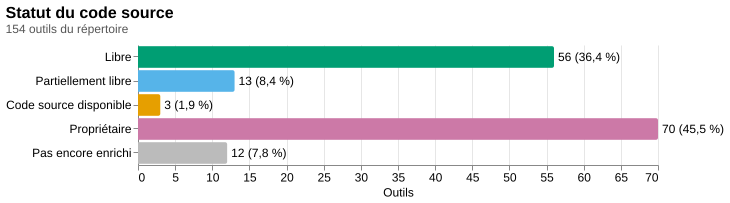

# Répertoire d'outils favorisant la souveraineté numérique : données

*Documentation : [README](README.md) · [Implémentation](implementation.md) · [Historique](historique.md) · [Sommaire statistique](donnees/sommaire.md)*

## En bref

Ce dépôt est une extraction en JSON du [répertoire d'outils favorisant la souveraineté numérique](https://praxis.encommun.io/n/voRYZbuBYZKLejs8JyNkc5C4o7s/), une note publiée sur Praxis par La bande numérique (FCCF) pour les OSBL des arts et de la culture du Canada français. Le répertoire évalue 60 outils numériques, répartis en 20 catégories, selon trois critères (où restent les données, qui contrôle l'outil, de qui il dépend), et attribue à chacun 2 ou 3 étoiles. Le dépôt publie ces données sous une forme structurée et documentée (`outils.json`, `categories.json`, `criteres.json`, `tags.json`, `sources.json`, avec leurs schémas JSON), les tient à jour depuis la page en ligne, et y ajoute ce que la page ne dit pas : à quel critère chaque étoile correspond (déduit des descriptions), et, pour 142 outils sur 154 (57 des 60 outils de Praxis, les 22 services FACiL et 63 des 72 alternatives de Charles), un enrichissement par IA (description longue, tags, statut du code source, licence, dépôt de code, second avis sur la souveraineté) ainsi que les critères vérifiés d'après la page de l'outil, citation à l'appui. Il accueille aussi d'autres sources : les 22 [Services FACiLes](https://facil.services/) (logiciels libres hébergés au Québec par FACiL, avec le logiciel sous-jacent et les services qu'ils remplacent), 72 alternatives européennes aux services américains tirées des données de [Charles](https://gitlab.com/yaniskerdjana/charles) (extension Chrome de Yanis Kerdjana ; la source ne décrit pas ses outils : leur description est composée depuis le pays, le tarif et les caractéristiques qu'elle donne) et des outils ajoutés à la main, chacun rattaché à sa source (`sources.json`). Avec ces sources, le répertoire s'adresse aux organismes et aux petites équipes du Canada français, au-delà des seuls OSBL des arts et de la culture.

Le [sommaire statistique](donnees/sommaire.md) qui en résulte distingue 56 logiciels libres, 13 partiellement libres, 3 à code source disponible et 70 propriétaires parmi les 142 outils enrichis, avec les licences, les forges de code, les tags et les critères de souveraineté par statut du code source. Les données sont sous licence CC BY-SA 4.0 (comme la source, dont elles sont une adaptation), le code sous AGPL-3.0-or-later. Les champs produits par IA sont des résumés de pages tierces, à vérifier avant de s'y fier ; la démarche, ses limites et ses mesures sont documentées dans [implementation.md](implementation.md) et [historique.md](historique.md).



*Statut du code source des outils du répertoire, d'après [`sommaire.md`](donnees/sommaire.md) (image produite par `node sommaire.ts`).*

Le dépôt contient aussi un **site statique de consultation** ([`site/`](packages/site/README.md)) : un accueil qui présente le projet, une page « Explorer » qui liste les outils par catégorie, même sans JavaScript, et permet de les trier, de les filtrer et d'en comparer de deux à quatre côte à côte, une fiche par outil, et une page de statistiques qui reprend les graphiques du sommaire, avec la provenance de chaque champ et l'attribution sur chaque page. Il se bâtit à partir des fichiers JSON, sans les modifier, et se publie sur GitHub Pages à chaque changement de la branche principale (<https://millette.github.io/repsouv/>, une fois GitHub Pages activé dans les réglages du dépôt ; voir [`site/README.md`](packages/site/README.md#publication)).

**Sommaire :** [Démarrage rapide](#démarrage-rapide) · [Source, crédits et licences](#source-crédits-et-licences) · [Autres commandes](#autres-commandes) · [Outils à installer](#outils-à-installer) · [Fichiers JSON](#fichiers-json) · [Sommaire statistique](#sommaire-statistique) · [Utiliser les données](#utiliser-les-données) · [Documentation](#documentation)

## Démarrage rapide

Les mises à jour peuvent **coûter de l'argent** : l'enrichissement par IA et le résumé du sommaire passent par l'API OpenAI, facturée à l'usage. Le premier `node update.ts` est le plus coûteux (il enrichit tous les outils du répertoire : environ 3,60 $ en borne haute avec le modèle par défaut `gpt-6.1-sol`, moins de 1 $ en réalité d'après le [banc d'essai](analyse-effort/analyse.md), et jusqu'à 18 $ de plus dans le cas, jamais observé, où le repli `gpt-6-astra` devrait reprendre chaque appel ; 1,50 $ constaté pour 57 outils avec `gpt-6-astra`, cinq fois plus cher) ; les suivants ne paient que les outils nouveaux et, s'il y a eu des changements, un résumé. `node update.ts --dry-run` chiffre le travail et le coût estimés sans rien dépenser ni écrire, et le premier import demande une confirmation avant de dépenser.

**Utiliser** les scripts ne demande que Node.js ; **développer** (tests, types, schémas, licences) demande en plus [nub](https://nubjs.com/), voir [implementation.md](implementation.md).

1. **Node.js 26** (toute version 26.x, `engines.node` : `>=26 <27`), avec npm : <https://nodejs.org/>. Les scripts sont en TypeScript, que Node exécute tel quel.
2. **Cloner le dépôt** et s'y placer : `git clone https://github.com/millette/repsouv.git && cd repsouv`.
3. **Configurer la clé OpenAI** : `cp .env.example .env`, puis mettre la clé dans `OPENAI_API_KEY=`. Avec un compte OpenAI, la clé se crée sur <https://platform.openai.com/api-keys> (« Create new secret key » ; elle commence par `sk-` et n'est affichée qu'une fois) et le crédit se vérifie sur <https://platform.openai.com/account/billing/overview>. Le fichier `.env` est ignoré par Git et la clé n'est transmise qu'à `api.openai.com`. Sans clé, `update` synchronise les données mais saute tout ce qui passe par l'API (enrichissement, vérification, descriptions, résumé). Facultatif aussi : `OPENHUB_API_KEY`, clé de l'API [Open Hub](https://www.openhub.net/accounts/me/api_keys/new) (gratuite, 1 000 requêtes par jour), pour compléter les logiciels libres avec leurs données publiques (champ `openhub`). Facultatif : `OPENAI_MODEL` (modèle principal, `gpt-6.1-sol` par défaut), `OPENAI_MODEL_FALLBACK` (modèle de repli, `gpt-6-astra` par défaut, qui reprend un appel dont la réponse a été rejetée ; vide pour s'en passer) et `OPENAI_REASONING_EFFORT` (effort de raisonnement, `low` par défaut) ; ces valeurs viennent d'un [banc d'essai](analyse-effort/analyse.md) sur 20 outils.
4. **Installer les dépendances** : `npm install`. Pour les graphiques du sommaire, installer aussi [vl-convert](https://github.com/vega/vl-convert) (binaire ou `cargo install`, voir [Outils à installer](#outils-à-installer)) ; sans lui, le sommaire est sauté par `update` et `node sommaire.ts --sans-graphiques` reste possible.
5. **Premier import** : `node update.ts --dry-run` pour voir ce qui serait fait et le coût estimé, puis `node update.ts`, qui crée `outils.json`, `categories.json`, `criteres.json` et `sources.json` depuis la page en ligne, enrichit les outils par IA, vérifie leurs critères, citation à l'appui, décrit les catégories (après confirmation des coûts : 1 pour poursuivre, 2 pour arrêter), et génère `sommaire.md` et `graphiques/`. Le dépôt contenant déjà ces fichiers, cette étape ne s'applique qu'à partir d'un dossier vide ; sur un clone, `node update.ts` se contente de mettre à jour.
6. **Mises à jour** : `node update.ts`, aussi souvent que voulu. Il compare la page en ligne aux données, enrichit et vérifie les outils nouveaux et régénère le sommaire et les graphiques seulement si quelque chose a changé ; une page inchangée ne coûte rien.
7. **Pour développer** : installer [nub](https://nubjs.com/) (`curl -fsSL https://nubjs.com/install.sh | bash` ; aussi par Homebrew, npm ou mise), qui télécharge le Node.js déclaré dans `devEngines.runtime` de `package.json` (la dernière 26.x), installe les dépendances d'après `nub.lock` (`nub install`) et lance les scripts de `package.json` (`nub run test`, `nub run typecheck`, `nub run schemas`, `nub run licences`). Les scripts `update` et `sommaire` s'exécutent indifféremment par `node` ou par `nub run`.

## Source, crédits et licences

### Le répertoire d'origine

Le contenu du répertoire est l'œuvre des auteur·trices de la note, et non de ce dépôt :

> Sven Buridans, François Delnooz, Marie-Renee Duguay. (2026). *Répertoire d'outils favorisant la souveraineté numérique*. Praxis. <https://praxis.encommun.io/n/voRYZbuBYZKLejs8JyNkc5C4o7s/>

- La note a été produite par [**La bande numérique**](https://fccf.ca/initiatives/la-bande-numerique/), une initiative de la [Fédération culturelle canadienne-française (FCCF)](https://fccf.ca/).
- Elle est publiée sur **Praxis**, plateforme du projet [**En commun**](https://encommun.io/).
- Sauf indication contraire, les contenus publics de Praxis portent la licence [CC BY-SA 4.0](https://creativecommons.org/licenses/by-sa/4.0/deed.fr).

### Crédits

- **Code source de cet outil** (scripts, tests, configuration) : [Robin Millette](https://robin.millette.info/).
- **Fichiers JSON générés** (`outils.json`, `categories.json`, `criteres.json`, `tags.json`, `sources.json`) : les auteur·trices du répertoire cité ci-dessus (Sven Buridans, François Delnooz et Marie-Renee Duguay), pour le contenu d'origine, et [Robin Millette](https://robin.millette.info/), pour l'extraction, la classification, l'enrichissement et le vocabulaire de tags.
- **Autres sources** : les 22 services viennent de la page des [Services FACiLes](https://facil.services/) de FACiL ; les 72 alternatives viennent des données de l'extension [Charles](https://gitlab.com/yaniskerdjana/charles), de Yanis Kerdjana et des contributeurs de Charles (MIT).

### Licences

| Ce qui | Licence |
|---|---|
| **Code source, configuration et documentation** (`*.ts`, `test/`, `package.json`, `nub.lock`, `tsconfig*.json`, `README.md`, `implementation.md`, `historique.md`, `tickets/`, `site/`, `specs/`, `.github/workflows/`) | [GNU Affero General Public License v3.0](https://www.gnu.org/licenses/agpl-3.0.html), identifiant SPDX `AGPL-3.0-or-later` (version 3 de la licence ou toute version ultérieure). Texte complet dans [`LICENSE`](LICENSE). Chaque fichier de code commence par les en-têtes `SPDX-License-Identifier` et `SPDX-FileCopyrightText` |
| **Schémas JSON** (`schemas/*.schema.json`) | Même licence que le code, `AGPL-3.0-or-later`. Le JSON n'admet pas de commentaires : chaque schéma la déclare dans son mot-clé standard `$comment` (ajouté par `generer-schemas.ts`), et `REUSE.toml` la déclare pour `schemas/**` selon la spécification [REUSE](https://reuse.software/) |
| **Données** (`outils.json`, `categories.json`, `criteres.json`, `tags.json`, `sources.json`) et ce qui en est dérivé : le **sommaire** (`sommaire.md`), ses **graphiques** (`graphiques/`) et les résultats du banc d'essai (`analyse-effort/*.json`) | [CC BY-SA 4.0](https://creativecommons.org/licenses/by-sa/4.0/deed.fr), identifiant SPDX `CC-BY-SA-4.0`. Texte complet dans [`LICENSE-CC-BY-SA-4.0`](LICENSE-CC-BY-SA-4.0). Le JSON n'admet pas de commentaires : chaque fichier déclare sa licence dans `meta.data_license`, que les scripts maintiennent (voir [Fichiers JSON](#fichiers-json)) |
| **Skill Claude Code** `charting-vega-lite` (`.claude/skills/`), copié depuis [oaustegard/claude-skills](https://github.com/oaustegard/claude-skills) | [MIT](https://opensource.org/license/mit), © 2025 Oskar Austegard. Aide à la rédaction des graphiques Vega-Lite pendant le développement; rien du projet n'en dépend à l'exécution |
| **Autres skills et outils d'agents installés** : `astro` ([ianshk/astro-skills](https://github.com/ianshk/astro-skills), Ian Callaghan) et `daisyui` ([saadeghi/daisyui](https://github.com/saadeghi/daisyui), Pouya Saadeghi) dans `.agents/skills/` (liens depuis `.claude/skills/`), les commandes `speckit-*` et `.specify/` ([github/spec-kit](https://github.com/github/spec-kit), GitHub) ; `skills-lock.json` est leur fichier de verrouillage (sa propre licence dans `meta.$comment`, comme les schémas, et celle de chaque skill dans `skills.<nom>.meta`) | MIT pour chacun, tel que déclaré par son dépôt d'origine ; annotés dans `REUSE.toml`. Outils de développement, rien du projet n'en dépend à l'exécution |
| **Skill Claude Code** `solidjs` (`.claude/skills/solidjs/`), copie de projet du skill personnel de l'auteur, adaptée aux conventions du dépôt | `AGPL-3.0-or-later`, comme le code ; annoté dans `REUSE.toml`. Outil de développement, rien du projet n'en dépend à l'exécution |

Le dépôt suit la spécification [REUSE](https://reuse.software/) : les fichiers de code (`.ts`, `.tsx`, `.mjs`, `.css`, `.astro`, et le flux `.github/workflows/pages.yml`) portent leurs en-têtes, `REUSE.toml` déclare la licence et le droit d'auteur des autres (données, sommaire, graphiques, configuration, documentation, schémas), et `LICENSES/` contient le texte de chaque licence utilisée. Pour les données, le droit d'auteur nomme les trois auteurs du répertoire d'origine, Yanis Kerdjana et les contributeurs de Charles, et Robin Millette. `nub run licences` vérifie le tout.

Les données sont des adaptations du répertoire d'origine : elles restent donc partagées dans les mêmes conditions que lui (CC BY-SA 4.0), avec attribution. Pour les réutiliser, créditer par exemple ainsi :

> Données : Sven Buridans, François Delnooz et Marie-Renee Duguay, *Répertoire d'outils favorisant la souveraineté numérique* (Praxis, 2026), adaptées par [Robin Millette](https://robin.millette.info/). CC BY-SA 4.0.

Pour les alternatives de Charles, créditer aussi Yanis Kerdjana et les contributeurs de [Charles](https://gitlab.com/yaniskerdjana/charles), dont les données sont sous licence MIT.

Les champs d'enrichissement résument des pages tierces (voir [D'où viennent les champs](#doù-viennent-les-champs)) : la licence des données ne se substitue pas à celle des sites des outils.

### D'où viennent les champs

- **De la source :** la catégorie (nom et icône), le nom, le score, le lien et la description de chaque outil, ainsi que les trois critères. La source de chaque outil est nommée par `source_repertoire_id` (voir [`sources.json`](#sourcesjson)) : Praxis, ou les Services FACiLes (nom, lien, description, logiciel sous-jacent et services remplacés, lus sur <https://facil.services/> ; catégorie attribuée par logiciel dans `extract-facil.ts`) ; ou Charles (nom, lien, pays, tarif, caractéristiques et sites américains remplacés, lus dans le dossier `data/` du dépôt GitLab ; catégorie attribuée par tables dans `extract-charles.ts`, description composée en français de ces champs) ; un outil ajouté à la main avec `node ajouter.ts` a une description rédigée par la personne qui l'ajoute et, sans étoiles, un score estimé (`score_estime`).
- **D'Open Hub** (données publiques, [openhub.net](https://www.openhub.net/)) : `openhub_id` et `openhub` des logiciels au code public (activité, contributeurs, commits, licences déclarées, langage, taille), relevés par `update` avec `OPENHUB_API_KEY`.
- **Rédigé pour ce dépôt :** le vocabulaire de `tags.json` (identifiants et descriptions des 37 tags de départ et des 15 ajoutés pour les alternatives de Charles), les cinq catégories déclarées par `extract-charles.ts` (nom et icône ; la description reste générée) et les tables de cet extracteur (catégories, pays, tarifs, caractéristiques en français).
- **Calculé et généré par les scripts :** `sommaire.md` et `graphiques/` (statistiques calculées à partir des données, plus un résumé rédigé par un modèle d'IA).
- **Calculé par les scripts :** `meta` (licence et dates des fichiers), `derniere_modification`, `changement`, `removed`, `enrichi_le` et `voir_aussi` (voir `update.ts`, `enrichir.ts`, `logiciel.ts` et `fichiers.ts`).
- **Déduit par heuristique dans ce dépôt :** `criteres` et `confiance` (voir [Classification](implementation.md#classification)).
- **Vérifié par un modèle d'IA, citation à l'appui :** `criteres_confirmes` (voir [`confirmer.ts`](implementation.md#confirmerts)). La citation permet de contrôler chaque verdict ; le verdict lui-même reste celui d'un modèle.
- **Généré par un modèle d'IA :** la description de chaque catégorie (`categories.json`), et les champs d'enrichissement (voir [Enrichissement](implementation.md#enrichissement-par-ia)). Ils résument des pages tierces et sont à vérifier avant de s'y fier ou de les diffuser, surtout la licence et le dépôt.

## Autres commandes

Tout ce que le [démarrage rapide](#démarrage-rapide) ne couvre pas (flux de travail, scripts, options, dépannage) est dans [implementation.md](implementation.md).

Utilisation, avec Node.js seulement :

```sh
node update.ts --dry-run         # montre ce que update ferait (changements, outils à enrichir, jetons et coût estimés), sans rien écrire
node update.ts                   # synchronise les données avec la page, enrichit par IA les outils qui ne le sont pas encore, vérifie leurs critères, décrit les catégories (OPENAI_API_KEY), puis met le sommaire à jour si quelque chose a changé
node update.ts --accepter-couts  # premier import hors terminal: accepte les coûts d'enrichissement sans la confirmation interactive
node sommaire.ts                 # écrit sommaire.md et graphiques/ (--sans-resume, --sans-graphiques pour s'en passer, --sans-couleur)
node extract-facil.ts [--fichier=page.html]   # synchronise les Services FACiLes (source facil) dans outils.json; node update.ts enrichit ensuite les nouveaux
node extract-charles.ts [--dossier=clone]     # synchronise les alternatives de Charles (source charles, dépôt GitLab ou clone local) dans outils.json, sources.json et categories.json; node update.ts enrichit ensuite les nouveaux
node ajouter.ts <lien> --nom=… --categorie=<id> --description=… --source=<id> [--score=N] [--alternative-a=url,…] [--source-nom=… --source-url=… --soumis-par-nom=…]
                                 # ajoute à la main un outil (et sa source dans sources.json); node update.ts l'enrichit ensuite
```

Site de consultation, avec nub, dans `site/` (voir [`site/README.md`](packages/site/README.md)) :

```sh
nub install && nub run build     # bâtit site/dist/ à partir des JSON de la racine (158 pages), sans appel réseau ni vl-convert; demande `nub install` à la racine
nub run dev                      # serveur de développement
nub run test && nub run test:e2e # tests unitaires, tests du site bâti, puis tests dans Chromium
```

Développement, avec nub (commandes définies dans `package.json`) :

```sh
nub run test                     # lance les tests unitaires, puis ceux des données réelles, puis vérifie que les schémas JSON sont à jour
nub run test:unit                # tests unitaires seulement (sans données: fonctionne avant le premier update)
nub run test:data                # tests des fichiers de données réels (outils.json, categories.json, criteres.json, tags.json, sources.json, sommaire.md)
nub run typecheck                # vérifie les types
nub run schemas                  # régénère schemas/*.schema.json à partir des types
nub run licences                 # vérifie la conformité REUSE des licences (uvx reuse lint; demande uv)
```

## Outils à installer

Ce que chaque usage demande, et comment l'installer en ligne de commande sous Linux, macOS et WSL (Windows Subsystem for Linux : les commandes Linux s'y appliquent telles quelles, après `wsl --install` dans un terminal Windows). Les versions indiquées sont celles avec lesquelles le dépôt a été produit.

| Outil | Rôle | Qui en a besoin | Version |
|---|---|---|---|
| [Node.js](https://nodejs.org/) | Exécute les scripts TypeScript tels quels ; `npm install` installe les dépendances | Utilisation et développement | 26.x (`engines.node` : `>=26 <27`) |
| [vl-convert](https://github.com/vega/vl-convert) | Convertit les graphiques Vega-Lite du sommaire en SVG | Utilisation, pour `sommaire.md` (sinon `--sans-graphiques`) | 1.9 |
| [nub](https://nubjs.com/) | Exécuteur TypeScript et gestionnaire de paquets du développement : Node.js de `devEngines.runtime`, `nub.lock`, `nub run …` | Développement | 0.11 |
| [uv](https://docs.astral.sh/uv/) | `uvx reuse lint` (`nub run licences`) vérifie la conformité REUSE des licences | Développement | 0.13 |
| [Git](https://git-scm.com/) | Cloner le dépôt et suivre l'historique des données | Les deux | 2.x |
| [jaq](https://github.com/01mf02/jaq) | Facultatif : les exemples de requêtes de [Utiliser les données](#utiliser-les-données) (jq convient aussi) | Lecture des données | 3.x |
| [Rust](https://rustup.rs/) (`cargo`) | Facultatif : compiler vl-convert ou jaq soi-même plutôt que télécharger un binaire | Rien d'obligatoire | stable |

Une clé [OpenAI](https://platform.openai.com/api-keys) complète l'installation pour l'enrichissement et le résumé (voir le [démarrage rapide](#démarrage-rapide)) ; sans elle, tout fonctionne sauf ce qui passe par l'API.

**Node.js 26.** Avec [fnm](https://github.com/Schniz/fnm), qui lit `.node-version` du dépôt (Linux, macOS, WSL) :

```sh
curl -fsSL https://fnm.vercel.app/install | bash   # puis rouvrir le terminal
fnm install 26 && fnm use 26 && node --version
```

Autres voies : sur Debian ou Ubuntu (WSL compris), le dépôt [NodeSource](https://github.com/nodesource/distributions) (`curl -fsSL https://deb.nodesource.com/setup_26.x | sudo -E bash - && sudo apt-get install -y nodejs`) ; sur macOS, `brew install fnm` puis les mêmes commandes `fnm` (Homebrew n'offre pas la ligne 26 en formule figée) ; ou les installateurs de <https://nodejs.org/>. Si nub est installé, il télécharge lui-même la bonne version : rien d'autre à faire.

**vl-convert 1.9.** Un binaire par plateforme sur la [page des versions](https://github.com/vega/vl-convert/releases) (archive `vl-convert_<plateforme>.zip`, le programme dans `bin/`) ; à placer dans un dossier du `PATH`, par exemple `~/.local/bin` :

```sh
# Linux x86_64 et WSL : vl-convert_linux-64 ; Linux arm64 : vl-convert_linux-aarch64
# macOS Apple Silicon : vl-convert_osx-arm64 ; macOS Intel : vl-convert_osx-64
curl -fsSL -o /tmp/vl-convert.zip https://github.com/vega/vl-convert/releases/latest/download/vl-convert_linux-64.zip
unzip -o -j /tmp/vl-convert.zip bin/vl-convert -d ~/.local/bin && vl-convert --version
```

Ou, avec Rust installé, `cargo install vl-convert` (compilation de quelques minutes).

**nub 0.11** (Linux, macOS, WSL ; aussi par Homebrew, npm ou mise, voir le site) :

```sh
curl -fsSL https://nubjs.com/install.sh | bash   # installe nub dans ~/.nub/bin et l'ajoute au PATH du profil
nub install && nub run test                     # dans le dépôt : dépendances d'après nub.lock, puis les tests
```

**uv** (Linux, macOS, WSL ; `brew install uv` sur macOS) :

```sh
curl -LsSf https://astral.sh/uv/install.sh | sh
```

**Git** : `sudo apt-get install -y git` (Debian, Ubuntu, WSL), `xcode-select --install` ou `brew install git` (macOS).

**jaq** (facultatif) : `brew install jaq` (macOS), `cargo install jaq`, ou un binaire de la [page des versions](https://github.com/01mf02/jaq/releases) (`jaq-x86_64-unknown-linux-gnu`, `jaq-aarch64-apple-darwin`, etc.) à copier dans `~/.local/bin` sous le nom `jaq`.

**Rust** (facultatif) : `curl --proto '=https' --tlsv1.2 -sSf https://sh.rustup.rs | sh`, puis rouvrir le terminal.

Sur Linux et WSL, vérifier que `~/.local/bin` est dans le `PATH` (`echo "$PATH"`) ; sinon ajouter `export PATH="$HOME/.local/bin:$PATH"` à `~/.bashrc` ou `~/.zshrc`.

## Fichiers JSON

Les cinq fichiers de données sont validés par des [schémas JSON](implementation.md#schémas-json) (`schemas/`, draft 2020-12). Ils ont la même structure : un objet dont le champ `meta` porte les métadonnées du fichier, suivi du tableau de données.

```json
{
  "meta": {
    "data_license": "CC-BY-SA-4.0",
    "created_at": "2026-11-12T12:35:52-05:00",
    "updated_at": "2026-11-12T13:01:11-05:00"
  },
  "outils": [ ... ]
}
```

| Champ | Description |
|---|---|
| `meta.data_license` | Licence des données, toujours `CC-BY-SA-4.0` (identifiant SPDX). Si un fichier en porte une autre, les scripts la rétablissent à l'écriture (un fichier sans `data_license` est refusé) |
| `meta.created_at` | Date et heure de création du fichier. Fixée une fois, puis conservée par tous les scripts, même quand `extract` remplace le contenu |
| `meta.updated_at` | Date et heure de la dernière modification du **contenu**. Un script qui réécrit le même contenu ne la change pas |
| `outils`, `categories`, `criteres`, `tags` ou `sources` | Le tableau de données, nommé d'après le fichier |

**Toutes les dates et heures sont locales, en heure de Toronto** (`America/Toronto`, heure d'été comprise), au format ISO 8601 avec le décalage : `-05:00` en hiver, `-04:00` en été. C'est le cas de `meta.created_at` et `meta.updated_at`, et aussi de `derniere_modification` de chaque outil. Cette dernière est la date affichée par la page d'origine, qui donne l'heure de l'Est (Toronto), à laquelle on ajoute le décalage de la saison; elle ne se confond pas avec `meta.updated_at`, qui date des écritures du fichier.

Le format est **strict** : un fichier de données qui n'a pas cette structure (sans `meta` complet, simple tableau, dates de `meta` sans décalage) est refusé avec un message clair. Pour le recréer depuis la page en ligne, voir [Importer ou réimporter depuis le web](implementation.md#importer-ou-réimporter-depuis-le-web).

### `outils.json`

Fichier unifié : le tableau `outils` contient 154 outils, 60 du répertoire Praxis, 22 des Services FACiLes et 72 alternatives de Charles (plus d'éventuels outils retirés). Chaque outil contient :

| Champ | Description |
|---|---|
| `categorie` | Identifiant de la catégorie : `categories[].id` de [`categories.json`](#categoriesjson) (le schéma impose un slug et annote le renvoi ; un test vérifie que chaque valeur existe) |
| `nom` | Nom de l'outil. Sert de clé d'identification : unique dans le fichier, et c'est par lui que `update`, `extract-facil` et `extract-charles` apparient les outils d'une source avec sa page. Une alternative de Charles qui porte le nom d'un outil actif d'une autre source (casse et espaces ignorés) n'est pas importée : l'extracteur la liste |
| `source_repertoire_id` | Identifiant de la source de l'outil : `sources[].id` de [`sources.json`](#sourcesjson) (`praxis` pour le répertoire Praxis ; une autre valeur pour un outil ajouté à la main ou extrait d'une autre collection). `update` ne retire que les outils de la source qu'il synchronise |
| `score` | Nombre d'étoiles ★ sur 3, donné par la source |
| `score_estime` | Présent (`true`) quand la source ne donne pas d'étoiles (services FACiL, alternatives de Charles, outil ajouté à la main sans `--score`) : `score`, `criteres` et `confiance` viennent de l'évaluation enrichie, ou, avant l'enrichissement, de la classification par seuil de la description |
| `alternative_a` | Services, souvent propriétaires, auxquels l'outil se substitue (liste d'URL), quand la source le dit (FACiL : « Remplace : … », converti en URL par `extract-facil.ts` ; Charles : l'URL du premier domaine de chaque site américain de `sites-us.json` qui propose l'outil ; ou `--alternative-a` de `ajouter.ts`) ; absent sinon |
| `instance_de` | Logiciel libre dont l'outil est une instance hébergée : `{ nom, url }` (nom et lien vers le dépôt ou la version, tels que la source les donne ; FACiL : « Est une instance de : … ») ; absent sinon. L'enrichissement, la vérification des critères et la recherche Open Hub portent alors sur ce logiciel (son dépôt, ramené à sa racine) plutôt que sur la page du service |
| `voir_aussi` | Noms des autres outils qui reposent sur le même logiciel (leur `nom`, ou leur `instance_de.nom` pour un service), par exemple « Mastodon » et « Jasette FACiLe », qui en est une instance ; recalculé à chaque écriture, absent sinon. Transmis au modèle dans la fiche d'enrichissement, qui peut les mentionner dans `description_longue` |
| `pays` | Pays de l'éditeur, tel que la source le donne (code ISO 3166-1 alpha-2, ou `EU`, `UK`), quand elle le dit (Charles : `country`) ; absent sinon. Transmis au modèle dans les fiches d'enrichissement et de vérification comme une affirmation de la source, à confronter à la page ; un changement de pays dans la source compte comme une modification |
| `lien` | Lien externe de l'outil |
| `description` | Description fournie par la source |
| `derniere_modification` | Dernière date de modification connue : ISO 8601 en heure de Toronto, avec le décalage (ex. `2026-11-05T09:53:00-05:00`). Praxis : la date affichée par la page ; FACiL : la date de lecture (la page n'en affiche pas) ; Charles : la date du dernier commit touchant `data/` dans le dépôt (ou de lecture si l'API GitLab ne répond pas) |
| `changement` | Dernier changement détecté par `update.ts` : `"nouveau"`, `"modification"`, `"retrait"` ou `"comeback"`; `null` si jamais modifié depuis l'import |
| `removed` | Présent (`true`) seulement pour un outil disparu de la page; l'entrée est conservée, à la fin du tableau |
| `echecs_enrichissement`, `echecs_confirmation`, `echecs_openhub` | Nombre d'échecs consécutifs d'enrichissement, de vérification des critères, et de recherche Open Hub (page inaccessible ou presque vide, réponses invalides). Présent seulement tant que l'étape a échoué au moins une fois sans réussir depuis (pour Open Hub, sur un outil déjà enrichi) ; retiré dès qu'elle réussit. À 3 (`--max-echecs=N` pour changer), `update` ne tente plus l'outil |
| `criteres` | Identifiants (voir `criteres.json`) des critères que les étoiles représentent. Déduits, voir [Classification](implementation.md#classification) |
| `confiance` | Fiabilité de cette déduction : `"élevée"`, `"moyenne"`, `"faible"`, ou `"indéterminée"` quand la source ne donne pas de score |

Champs ajoutés par l'[enrichissement](implementation.md#enrichissement-par-ia), absents tant que l'outil n'est pas enrichi :

| Champ | Description |
|---|---|
| `description_longue` | Description détaillée en français (150 à 350 mots), en Markdown (plusieurs paragraphes, titres, gras, italique, listes), sans image, sans HTML, sans tiret cadratin et sans émoji ni émoticône. Pour un service, elle décrit le service et son logiciel, et peut nommer les outils de `voir_aussi` |
| `tags` | De 1 à 5 identifiants de `tags.json` |
| `source` | Statut du code source : `"libre"` (licence libre, code public), `"partiel"` (édition communautaire libre mais édition complète ou services propriétaires, « open core »), `"source-disponible"` (code visible, licence non libre) ou `"proprietaire"` |
| `licence` | Expression de licence [SPDX](https://spdx.org/licenses/) valide (ex. `AGPL-3.0-or-later`, `MIT OR Apache-2.0`); `null` pour un logiciel propriétaire, si elle est inconnue ou si aucun identifiant SPDX ne convient |
| `custom_license` | Nom ou identifiant d'une licence absente de la liste SPDX (licence maison ou propre à l'éditeur), tel que l'éditeur l'écrit. Exclusif avec `licence`; `null` si la licence est SPDX, si le logiciel est propriétaire ou si elle est inconnue |
| `custom_license_url` | URL du texte de la licence maison, quand elle est disponible; `null` sinon. Exige `custom_license` |
| `repo` | URL du dépôt de code source, sur n'importe quelle forge (GitHub, GitLab, Codeberg, Framagit…); `null` si aucun ou inconnu |
| `enrichi_le` | Date et heure de l'enrichissement de l'outil (ISO 8601, heure de Toronto), exacte pour chaque outil : 49 outils de Praxis datent du réimport du 2026-11-12 (de 12:36 à 12:55), 61 alternatives de Charles du 2026-11-13 (de 09:53 à 10:04), 2 autres (Infomaniak kDrive et La Suite, après correction de leur lien) de 10:27, et les 30 outils ré-enrichis pour les tags ajoutés ce jour-là (les 22 services FACiL, Firefox, Thunderbird, Framapad, Mobilizon, Mastodon, La Digitale, Omeka S et CiviCRM) du 2026-11-13 (de 10:09 à 10:15) |
| `evaluation_enrichie` | Second avis du modèle sur la souveraineté de l'outil : `score` (nombre de critères satisfaits, de 0 à 3, égal à `criteres.length`), `criteres` (identifiants de `criteres.json`) et `confiance` (`"élevée"`, `"moyenne"` ou `"faible"`). S'y ajoute `ecart`, une explication en français de la différence, seulement quand cette évaluation diffère du `score` et des `criteres` du répertoire |
| `criteres_confirmes` | Critères **vérifiés** par une IA d'après la page de l'outil, citation à l'appui (`confirmer.ts`, appelé par `update`) : `criteres` (ceux qui sont confirmés, dans l'ordre de `criteres.json`), `preuves` (une citation copiée mot pour mot de la description ou de la page, pour chaque critère confirmé), `infirmes` (une citation pour chaque critère que la page contredit ; un critère absent des deux est indéterminé), `modele` et `date` (heure de Toronto). Indépendant de `criteres`, qui reste lié aux étoiles : il peut en compter moins, jamais plus. Rempli par `update` pour tout outil enrichi qui ne l'a pas encore, avec le modèle de l'enrichissement (`gpt-6.1-sol` par défaut) ou, si celui-ci a dû prendre la relève, le modèle de repli : `modele` nomme celui qui a produit le verdict ; règle de lecture « la nationalité mentionnée suffit » pour « contrôle ». Présent pour les 142 outils enrichis : les 57 de Praxis vérifiés par `gpt-6-astra` (le modèle par défaut d'alors), les 22 services FACiL (d'après la page de leur logiciel) et 62 des 63 alternatives de Charles par `gpt-6.1-sol`, la dernière (Proton Drive) par le repli `gpt-6-astra` ; conservé au ré-enrichissement d'un outil |

Champs relevés sur [Open Hub](https://www.openhub.net/) par `update` (`openhub.ts`, clé `OPENHUB_API_KEY`), seulement pour les logiciels au code public (`source` libre, partiel ou source-disponible) dont un projet Open Hub concorde avec la page de l'outil (`lien`, ou le dépôt de son logiciel pour un service, voir `instance_de`) ou avec `repo` :

| Champ | Description |
|---|---|
| `openhub_id` | Nom court du projet sur Open Hub (`vanity_name`, ex. `jami`) : page <https://www.openhub.net/p/jami> |
| `openhub` | `organisation` (porteuse du projet), `activite` (indice Open Hub : « Inactive » à « Very High »), `licences` (noms Open Hub, à comparer à `licence`), `langage_principal`, `lignes_de_code`, `contributeurs_total`, `contributeurs_12_mois`, `commits_12_mois`, `premier_mois`, `dernier_mois` (`null` quand Open Hub ne le donne pas) et `consulte_le` (date de la lecture) |

La page n'affiche qu'une seule date pour toute la note. `derniere_modification` est donc la date de la page au moment où l'outil a été ajouté ou a changé, et non la date exacte du changement de cet outil.

### `categories.json`

Les catégories du répertoire (25 : les 20 de la page Praxis et 5 déclarées par `extract-charles.ts`, paiement en ligne, assistants d'intelligence artificielle, hébergement Web et infrastructure, commerce en ligne, diffusion audio et vidéo), dans le tableau `categories`, sous forme de `{ id, nom, icone, description, source_repertoire_id? }` : `id` est le slug du nom (minuscules sans accents, mots séparés par un tiret, ex. `gestion-d-evenements-et-billetterie`), `nom` et `icone` sont le titre `h3` de la page séparé en deux, et `description` est une à trois phrases en français rédigées par un modèle d'IA (`update`) à partir des outils de la catégorie, absente tant qu'elle n'a pas été générée. `extract` et `update` tiennent la liste à jour depuis la page en conservant les descriptions ; une catégorie renommée sur la page change d'identifiant. Une catégorie déclarée par un autre extracteur porte `source_repertoire_id` (l'identifiant de sa source dans `sources.json`) : `update` la conserve telle quelle, après celles de la page.

### `criteres.json`

Les trois critères du répertoire (« trois critères simples et concrets »), dans le tableau `criteres`, sous forme de `{ id, icon, titre, description }` :

| `id` | `icon` | Question |
|---|---|---|
| `donnees` | 📍 | Où peuvent rester les données ? |
| `controle` | 🏢 | Qui contrôle l'outil ? |
| `dependance` | 🔗 | De qui dépend-il pour fonctionner ? |

Les `id` sont la forme courte utilisée dans les champs `criteres` de `outils.json`.

### `tags.json`

Le vocabulaire restreint de tags : le tableau `tags` contient des `{ id, description }`, avec une description en français pour chaque tag (37 au départ, puis 15 ajoutés à la main le 2026-11-13 pour ce que les alternatives de Charles apportent : hébergement en Europe, porté par un OSBL, certification de sécurité, sans publicité, écoresponsable, agenda et rendez-vous, VPN, développement logiciel, traduction, sans code, moteur de recherche, formation en ligne, téléphonie, gestion des correctifs, cartographie). Chaque outil reçoit de 1 à 5 de ces tags, jamais plus.

De nouveaux tags peuvent s'ajouter après cette première phase, avec `node update.ts --nouveaux-tags`. Chaque tag ajouté doit être **justifié** : il porte alors en plus un champ `justification` (pourquoi aucun tag existant ne convient) et `propose_pour` (l'outil pour lequel il a été proposé). Un nouveau tag peut ne concerner qu'un seul outil.

### `sources.json`

Les sources des outils, dans le tableau `sources` : `{ id, nom, url, extracteur, pdc?, donnees?, soumis_par? }`. `id` est un slug référencé par `outils[].source_repertoire_id` ; `extracteur` dit qui sait lire la source : `praxis` (le répertoire, extrait par `extract.ts`), `facil` (les [Services FACiLes](https://facil.services/), extraits par `extract-facil.ts`), `charles` (les alternatives de [Charles](https://gitlab.com/yaniskerdjana/charles), extraites par `extract-charles.ts`) ou `manuel` (outils saisis avec `node ajouter.ts`) ; `pdc` et `donnees` sont les pages de politique de confidentialité et de données de la collection, quand elle en publie ; `soumis_par` dit qui a soumis une collection ajoutée à la main (`nom` obligatoire, `url` et `email` facultatifs ; le courriel, s'il est donné, est publié avec les données). `update` crée le fichier avec la source `praxis` s'il manque ; `ajouter.ts` y ajoute les sources manuelles.

## Sommaire statistique

[`sommaire.md`](donnees/sommaire.md) est généré par `node sommaire.ts` à partir des données (voir [Génération du sommaire statistique](implementation.md#génération-du-sommaire-statistique)) ; sa première ligne donne la date de génération, et son résumé est rédigé par un modèle d'IA, à relire. Au 2026-11-13 :

- **154 outils** répartis en **25 catégories** : 60 du répertoire Praxis (**8 à 3 étoiles** et **52 à 2 étoiles**), 22 des Services FACiLes et 72 alternatives de Charles, ces 94 au score estimé d'après leur évaluation enrichie (13 à 2 étoiles, 24 à 1, 57 à 0).
- **142 outils enrichis** sur 154 (les 3 outils de Praxis et les 9 alternatives de Charles dont la page est illisible restent à enrichir), dont **69 logiciels libres ou partiellement libres** (48,6 %) : 56 libres (les 21 services FACiL libres et le logiciel de Praxis qu'ils font tourner comptent chacun), 13 partiellement libres, 3 à code source disponible, 70 propriétaires.
- **12 licences SPDX distinctes**, **8 forges de code** et les **52 tags** du vocabulaire utilisés ; pays de l'éditeur connu pour les 72 alternatives de Charles (30 en France, 12 en Suisse, 12 en Allemagne).
- Critères déduits des descriptions (`criteres`) : « données » pour 76 outils, « contrôle » pour 48, « dépendance » pour 54 (les 60 outils de Praxis, un critère par étoile ; les autres alignés sur leur évaluation enrichie). Critères **vérifiés** d'après la page de l'outil ou de son logiciel (`criteres_confirmes`, 142 outils) : « données » confirmé pour 69, infirmé pour 44, indéterminé pour 29 ; « contrôle » confirmé pour 26, infirmé pour 93, indéterminé pour 23 ; « dépendance » confirmé pour 42, infirmé pour 47, indéterminé pour 53.
- **42 outils** avec des données Open Hub ; **18 outils** reliés par `voir_aussi` (les 8 logiciels communs à Praxis et aux Services FACiLes, et GitLab avec Code FACiLe).

Le sommaire détaille chaque point par catégorie et par statut du code source, avec neuf graphiques, les licences, les forges, les données Open Hub, les tags et les écarts entre les critères déduits, l'évaluation enrichie et les critères vérifiés.

## Utiliser les données

Pour un aperçu chiffré, voir [`sommaire.md`](donnees/sommaire.md). Pour obtenir le répertoire courant, ignorer les outils portant `removed`. Pour les logiciels libres, filtrer sur `source` (`libre` ou `partiel`) et utiliser `licence` (ou `custom_license`) et `repo`. Par exemple, avec [jaq](https://github.com/01mf02/jaq) :

```sh
# licence et dates du fichier
jaq '.meta' outils.json

# nom et icône de la catégorie de chaque outil (jointure sur categories.json)
jaq --slurpfile cats categories.json '($cats[0].categories | map({(.id): .}) | add) as $c | .outils[] | {nom, categorie: $c[.categorie].nom, icone: $c[.categorie].icone}' outils.json

# outils actuellement au répertoire
jaq '[.outils[] | select(.removed | not)]' outils.json

# logiciels libres enrichis, avec leur licence et leur dépôt
jaq '.outils[] | select(.source == "libre" or .source == "partiel") | {nom, licence, custom_license, repo}' outils.json

# outils enrichis depuis une date donnée
jaq '.outils[] | select(.enrichi_le != null and .enrichi_le >= "2026-11-12") | .nom' outils.json

# outils portant un tag
jaq '.outils[] | select((.tags // []) | index("chiffrement")) | .nom' outils.json

# services FACiL : le logiciel qu'ils font tourner, et les outils du répertoire qui reposent sur le même logiciel
jaq '.outils[] | select(.instance_de) | {nom, logiciel: .instance_de.nom, voir_aussi}' outils.json

# critères vérifiés par IA, avec la citation, quand ils diffèrent des étoiles
jaq '.outils[] | select(.criteres_confirmes and (.criteres_confirmes.criteres | length) < .score) | {nom, score, criteres, confirmes: .criteres_confirmes.criteres, preuves: .criteres_confirmes.preuves}' outils.json
```

## Documentation

| Fichier | Contenu |
|---|---|
| [README.md](README.md) | Ce fichier : le démarrage rapide, la source, les crédits et licences, les commandes, les outils à installer, les fichiers de données et comment les utiliser |
| [implementation.md](implementation.md) | Le flux de travail, le contenu du dépôt, les schémas, chaque script et ses options, la classification et ses analyses, l'enrichissement, la génération du sommaire, les scripts npm, les tests, le dépannage et les conventions de documentation |
| [historique.md](historique.md) | Les étapes du projet et les décisions prises, par date |
| [sommaire.md](donnees/sommaire.md) | Le sommaire statistique généré (données, dates, catégories, statuts, licences, critères, forges, tags, fiabilité) |
| [site/README.md](packages/site/README.md) | Le site de consultation : commandes, publication sur GitHub Pages, variables d'environnement, règles (données, provenance, lecture sans JavaScript, explorateur, statistiques, styles) et licences |
| `specs/` | Les artefacts Spec Kit de chaque fonctionnalité du site (spécification, plan, recherche, contrats, tâches) : `001-site-consultation-repertoire`, `002-explorateur-outils`, `003-page-statistiques`, `004-deploiement-github-pages` |
| [analyse-effort/analyse.md](analyse-effort/analyse.md) | Le banc d'essai des modèles et des efforts de raisonnement sur 20 outils, d'où viennent les valeurs par défaut |
| [tickets/charles-amont.md](tickets/charles-amont.md) | Brouillon du ticket à ouvrir au dépôt de Charles (fichier de licence manquant, alternatives sans site, alternative américaine, deux liens morts) ; pas encore ouvert |
| [.specify/memory/constitution.md](.specify/memory/constitution.md) | La constitution du projet : les six principes, les contraintes techniques, le flux de travail et la gouvernance que suivent les fonctionnalités menées avec [Spec Kit](https://github.com/github/spec-kit) |
