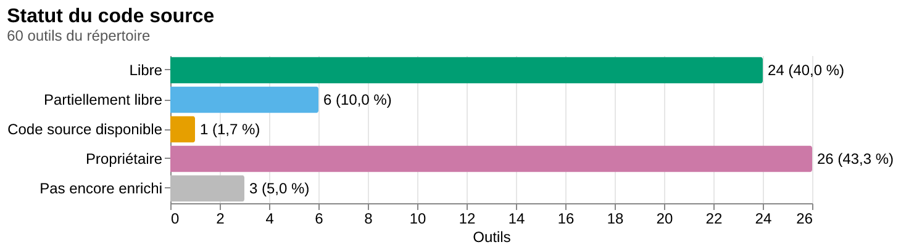

# Répertoire d'outils favorisant la souveraineté numérique : données

*Documentation : [README](README.md) · [Implémentation](implementation.md) · [Historique](historique.md) · [Sommaire statistique](sommaire.md)*

## En bref

Ce dépôt est une extraction en JSON du [répertoire d'outils favorisant la souveraineté numérique](https://praxis.encommun.io/n/voRYZbuBYZKLejs8JyNkc5C4o7s/), une note publiée sur Praxis par La bande numérique (FCCF) pour les OSBL des arts et de la culture du Canada français. Le répertoire évalue 60 outils numériques, répartis en 20 catégories, selon trois critères (où restent les données, qui contrôle l'outil, de qui il dépend), et attribue à chacun 2 ou 3 étoiles. Le dépôt publie ces données sous une forme structurée et documentée (`outils.json`, `criteres.json`, `tags.json`, avec leurs schémas JSON), les tient à jour depuis la page en ligne, et y ajoute ce que la page ne dit pas : à quel critère chaque étoile correspond (déduit des descriptions), et, pour 57 outils sur 60, un enrichissement par IA (description longue, tags, statut du code source, licence, dépôt de code, second avis sur la souveraineté) ainsi que les critères vérifiés d'après la page de l'outil, citation à l'appui.

Le [sommaire statistique](sommaire.md) qui en résulte distingue 24 logiciels libres, 6 partiellement libres, 1 à code source disponible et 26 propriétaires parmi les outils enrichis, avec les licences, les forges de code, les tags et les critères de souveraineté par statut du code source. Les données sont sous licence CC BY-SA 4.0 (comme la source, dont elles sont une adaptation), le code sous AGPL-3.0-or-later. Les champs produits par IA sont des résumés de pages tierces, à vérifier avant de s'y fier ; la démarche, ses limites et ses mesures sont documentées dans [implementation.md](implementation.md) et [historique.md](historique.md).



*Statut du code source des outils du répertoire, d'après [`sommaire.md`](sommaire.md) (image produite par `nub run sommaire`).*

**Sommaire :** [Source, crédits et licences](#source-crédits-et-licences) · [Usage en bref](#usage-en-bref) · [Fichiers JSON](#fichiers-json) · [Sommaire statistique](#sommaire-statistique) · [Utiliser les données](#utiliser-les-données) · [Documentation](#documentation)

## Source, crédits et licences

### Le répertoire d'origine

Le contenu du répertoire est l'œuvre des auteur·trices de la note, et non de ce dépôt :

> Sven Buridans, François Delnooz, Marie-Renee Duguay. (2026). *Répertoire d'outils favorisant la souveraineté numérique*. Praxis. <https://praxis.encommun.io/n/voRYZbuBYZKLejs8JyNkc5C4o7s/>

- La note a été produite par [**La bande numérique**](https://fccf.ca/initiatives/la-bande-numerique/), une initiative de la [Fédération culturelle canadienne-française (FCCF)](https://fccf.ca/).
- Elle est publiée sur **Praxis**, plateforme du projet [**En commun**](https://encommun.io/).
- Sauf indication contraire, les contenus publics de Praxis portent la licence [CC BY-SA 4.0](https://creativecommons.org/licenses/by-sa/4.0/deed.fr).

### Crédits

- **Code source de cet outil** (scripts, tests, configuration) : [Robin Millette](https://robin.millette.info/).
- **Fichiers JSON générés** (`outils.json`, `criteres.json`, `tags.json`) : les auteur·trices du répertoire cité ci-dessus (Sven Buridans, François Delnooz et Marie-Renee Duguay), pour le contenu d'origine, et [Robin Millette](https://robin.millette.info/), pour l'extraction, la classification, l'enrichissement et le vocabulaire de tags.

### Licences

| Ce qui | Licence |
|---|---|
| **Code source, configuration et documentation** (`*.ts`, `test/`, `package.json`, `nub.lock`, `tsconfig*.json`, `README.md`) | [GNU Affero General Public License v3.0](https://www.gnu.org/licenses/agpl-3.0.html), identifiant SPDX `AGPL-3.0-or-later` (version 3 de la licence ou toute version ultérieure). Texte complet dans [`LICENSE`](LICENSE). Chaque fichier `.ts` commence par les en-têtes `SPDX-License-Identifier` et `SPDX-FileCopyrightText` |
| **Schémas JSON** (`schemas/*.schema.json`) | Même licence que le code, `AGPL-3.0-or-later`. Le JSON n'admet pas de commentaires : chaque schéma la déclare dans son mot-clé standard `$comment` (ajouté par `generer-schemas.ts`), et `REUSE.toml` la déclare pour `schemas/**` selon la spécification [REUSE](https://reuse.software/) |
| **Données** (`outils.json`, `criteres.json`, `tags.json`) et ce qui en est dérivé : le **sommaire** (`sommaire.md`) et ses **graphiques** (`graphiques/`) | [CC BY-SA 4.0](https://creativecommons.org/licenses/by-sa/4.0/deed.fr), identifiant SPDX `CC-BY-SA-4.0`. Texte complet dans [`LICENSE-CC-BY-SA-4.0`](LICENSE-CC-BY-SA-4.0). Le JSON n'admet pas de commentaires : chaque fichier déclare sa licence dans `meta.data_license`, que les scripts maintiennent (voir [Fichiers JSON](#fichiers-json)) |

Le dépôt suit la spécification [REUSE](https://reuse.software/) : les fichiers `.ts` portent leurs en-têtes, `REUSE.toml` déclare la licence et le droit d'auteur de tous les autres (données, sommaire, graphiques, configuration, documentation, schémas), et `LICENSES/` contient le texte de chaque licence utilisée. Pour les données, le droit d'auteur nomme les trois auteurs du répertoire d'origine et Robin Millette. `nub run licences` vérifie le tout.

Les données sont des adaptations du répertoire d'origine : elles restent donc partagées dans les mêmes conditions que lui (CC BY-SA 4.0), avec attribution. Pour les réutiliser, créditer par exemple ainsi :

> Données : Sven Buridans, François Delnooz et Marie-Renee Duguay, *Répertoire d'outils favorisant la souveraineté numérique* (Praxis, 2026), adaptées par [Robin Millette](https://robin.millette.info/). CC BY-SA 4.0.

Les champs d'enrichissement résument des pages tierces (voir [D'où viennent les champs](#doù-viennent-les-champs)) : la licence des données ne se substitue pas à celle des sites des outils.

### D'où viennent les champs

- **De la source :** la catégorie, le nom, le score, le lien et la description de chaque outil, ainsi que les trois critères.
- **Rédigé pour ce dépôt :** le vocabulaire de `tags.json` (identifiants et descriptions des 37 tags de départ).
- **Calculé et généré par les scripts :** `sommaire.md` et `graphiques/` (statistiques calculées à partir des données, plus un résumé rédigé par un modèle d'IA).
- **Calculé par les scripts :** `meta` (licence et dates des fichiers), `derniere_modification`, `changement`, `removed` et `enrichi_le` (voir `update.ts`, `enrichir.ts` et `fichiers.ts`).
- **Déduit par heuristique dans ce dépôt :** `criteres` et `confiance` (voir [Classification](implementation.md#classification)).
- **Vérifié par un modèle d'IA, citation à l'appui :** `criteres_confirmes` (voir [`confirmer.ts`](implementation.md#confirmerts)). La citation permet de contrôler chaque verdict ; le verdict lui-même reste celui d'un modèle.
- **Généré par un modèle d'IA :** les champs d'enrichissement (voir [Enrichissement](implementation.md#enrichissement-par-ia)). Ils résument des pages tierces et sont à vérifier avant de s'y fier ou de les diffuser, surtout la licence et le dépôt.

## Usage en bref

Prérequis : [nub](https://nubjs.com/), qui exécute le TypeScript directement, et un accès au réseau (`update` et l'enrichissement téléchargent des pages en ligne). Le sommaire a besoin de [vl-convert](https://github.com/vega/vl-convert) pour ses graphiques, l'enrichissement et le résumé du sommaire d'une clé `OPENAI_API_KEY` dans `.env` (copier `.env.example`). Tout le reste, dont le flux de travail, les scripts, leurs options et le dépannage, est dans [implementation.md](implementation.md).

```sh
nub install                      # installe les dépendances
nub run test                     # lance les tests (et vérifie que les schémas JSON sont à jour)
nub run typecheck                # vérifie les types
nub run schemas                  # régénère schemas/*.schema.json à partir des types
nub run licences                 # vérifie la conformité REUSE des licences (uvx reuse lint; demande uv)
nub run update --dry-run         # montre ce que update ferait (changements, outils à enrichir, jetons et coût estimés), sans rien écrire
nub run update                   # synchronise outils.json et criteres.json avec la page, enrichit par IA les outils qui ne le sont pas encore (OPENAI_API_KEY) et met le sommaire à jour si quelque chose a changé
nub run update --accepter-couts  # premier import hors terminal: accepte les coûts d'enrichissement sans la confirmation interactive
nub run sommaire                 # écrit sommaire.md et graphiques/ (--sans-resume, --sans-graphiques pour s'en passer)
```

## Fichiers JSON

Les trois fichiers de données sont validés par des [schémas JSON](implementation.md#schémas-json) (`schemas/`, draft 2020-12). Ils ont la même structure : un objet dont le champ `meta` porte les métadonnées du fichier, suivi du tableau de données.

```json
{
  "meta": {
    "data_license": "CC-BY-SA-4.0",
    "created_at": "2026-11-11T16:43:11-05:00",
    "updated_at": "2026-11-11T16:48:12-05:00"
  },
  "outils": [ ... ]
}
```

| Champ | Description |
|---|---|
| `meta.data_license` | Licence des données, toujours `CC-BY-SA-4.0` (identifiant SPDX). Si un fichier en porte une autre, les scripts la rétablissent à l'écriture (un fichier sans `data_license` est refusé) |
| `meta.created_at` | Date et heure de création du fichier. Fixée une fois, puis conservée par tous les scripts, même quand `extract` remplace le contenu |
| `meta.updated_at` | Date et heure de la dernière modification du **contenu**. Un script qui réécrit le même contenu ne la change pas |
| `outils`, `criteres` ou `tags` | Le tableau de données, nommé d'après le fichier |

**Toutes les dates et heures sont locales, en heure de Toronto** (`America/Toronto`, heure d'été comprise), au format ISO 8601 avec le décalage : `-05:00` en hiver, `-04:00` en été. C'est le cas de `meta.created_at` et `meta.updated_at`, et aussi de `derniere_modification` de chaque outil. Cette dernière est la date affichée par la page d'origine, qui donne l'heure de l'Est (Toronto), à laquelle on ajoute le décalage de la saison; elle ne se confond pas avec `meta.updated_at`, qui date des écritures du fichier.

Le format est **strict** : un fichier de données qui n'a pas cette structure (sans `meta` complet, simple tableau, dates de `meta` sans décalage) est refusé avec un message clair. Pour le recréer depuis la page en ligne, voir [Importer ou réimporter depuis le web](implementation.md#importer-ou-réimporter-depuis-le-web).

### `outils.json`

Fichier unifié : le tableau `outils` contient 60 outils (plus d'éventuels outils retirés). Chaque outil contient :

| Champ | Description |
|---|---|
| `categorie` | Nom de la catégorie (le `h3`, sans l'icône) |
| `icone` | Icône de la catégorie, champ séparé |
| `nom` | Nom de l'outil. Sert de clé d'identification |
| `score` | Nombre d'étoiles ★ sur 3 |
| `lien` | Lien externe de l'outil |
| `description` | Description fournie par la source |
| `derniere_modification` | Dernière date de modification connue : ISO 8601 en heure de Toronto, avec le décalage (ex. `2026-11-05T09:53:00-05:00`) |
| `changement` | Dernier changement détecté par `update.ts` : `"nouveau"`, `"modification"`, `"retrait"` ou `"comeback"`; `null` si jamais modifié depuis l'import |
| `removed` | Présent (`true`) seulement pour un outil disparu de la page; l'entrée est conservée, à la fin du tableau |
| `echecs_enrichissement` | Nombre d'échecs consécutifs d'enrichissement (page inaccessible ou presque vide, réponses invalides). Présent seulement sur un outil pas encore enrichi qui a échoué au moins une fois ; retiré dès que l'enrichissement réussit. À 3 (`--max-echecs=N` pour changer), `update` ne tente plus l'outil |
| `criteres` | Identifiants (voir `criteres.json`) des critères que les étoiles représentent. Déduits, voir [Classification](implementation.md#classification) |
| `confiance` | Fiabilité de cette déduction : `"élevée"`, `"moyenne"` ou `"faible"` |

Champs ajoutés par l'[enrichissement](implementation.md#enrichissement-par-ia), absents tant que l'outil n'est pas enrichi :

| Champ | Description |
|---|---|
| `description_longue` | Description détaillée en français (150 à 350 mots), en Markdown (plusieurs paragraphes, titres, gras, italique, listes), sans image, sans HTML, sans tiret cadratin et sans émoji ni émoticône |
| `tags` | De 1 à 5 identifiants de `tags.json` |
| `source` | Statut du code source : `"libre"` (licence libre, code public), `"partiel"` (édition communautaire libre mais édition complète ou services propriétaires, « open core »), `"source-disponible"` (code visible, licence non libre) ou `"proprietaire"` |
| `licence` | Expression de licence [SPDX](https://spdx.org/licenses/) valide (ex. `AGPL-3.0-or-later`, `MIT OR Apache-2.0`); `null` pour un logiciel propriétaire, si elle est inconnue ou si aucun identifiant SPDX ne convient |
| `custom_license` | Nom ou identifiant d'une licence absente de la liste SPDX (licence maison ou propre à l'éditeur), tel que l'éditeur l'écrit. Exclusif avec `licence`; `null` si la licence est SPDX, si le logiciel est propriétaire ou si elle est inconnue |
| `custom_license_url` | URL du texte de la licence maison, quand elle est disponible; `null` sinon. Exige `custom_license` |
| `repo` | URL du dépôt de code source, sur n'importe quelle forge (GitHub, GitLab, Codeberg, Framagit…); `null` si aucun ou inconnu |
| `enrichi_le` | Date et heure de l'enrichissement de l'outil (ISO 8601, heure de Toronto). Les 41 outils enrichis avant l'ajout de ce champ portent la date de substitution `2026-11-11T17:29:24-05:00` (celle du premier enrichissement daté), qui n'est pas leur date exacte; la date des enrichissements suivants est exacte. Dans `outils.json`, 42 outils portent cette valeur : les 41 de substitution et le premier enrichissement daté |
| `page_lue` | `true` si la page de l'outil a servi à l'enrichissement; `false` si l'outil a été enrichi sans page lisible, à partir de sa seule description (ancienne option `--sans-page`, retirée : un outil dont la page est illisible n'est plus enrichi) |
| `evaluation_enrichie` | Second avis du modèle sur la souveraineté de l'outil : `score` (nombre de critères satisfaits, de 0 à 3, égal à `criteres.length`), `criteres` (identifiants de `criteres.json`) et `confiance` (`"élevée"`, `"moyenne"` ou `"faible"`). S'y ajoute `ecart`, une explication en français de la différence, seulement quand cette évaluation diffère du `score` et des `criteres` du répertoire |
| `criteres_confirmes` | Critères **vérifiés** par une IA d'après la page de l'outil, citation à l'appui (`confirmer.ts`, puis `appliquer-confirmations.ts`) : `criteres` (ceux qui sont confirmés, dans l'ordre de `criteres.json`), `preuves` (une citation copiée mot pour mot de la description ou de la page, pour chaque critère confirmé), `infirmes` (une citation pour chaque critère que la page contredit ; un critère absent des deux est indéterminé), `modele`, `regle` (règle de lecture ajoutée aux consignes, ou `null`) et `date` (heure de Toronto). Indépendant de `criteres`, qui reste lié aux étoiles : il peut en compter moins, jamais plus. Présent pour les 57 outils enrichis (modèle `claude-fable-5-2`), absent pour les autres |

La page n'affiche qu'une seule date pour toute la note. `derniere_modification` est donc la date de la page au moment où l'outil a été ajouté ou a changé, et non la date exacte du changement de cet outil.

### `criteres.json`

Les trois critères du répertoire (« trois critères simples et concrets »), dans le tableau `criteres`, sous forme de `{ id, icon, titre, description }` :

| `id` | `icon` | Question |
|---|---|---|
| `donnees` | 📍 | Où peuvent rester les données ? |
| `controle` | 🏢 | Qui contrôle l'outil ? |
| `dependance` | 🔗 | De qui dépend-il pour fonctionner ? |

Les `id` sont la forme courte utilisée dans les champs `criteres` de `outils.json`.

### `tags.json`

Le vocabulaire restreint de tags : le tableau `tags` contient des `{ id, description }`, avec une description en français pour chaque tag (37 au départ). Chaque outil reçoit de 1 à 5 de ces tags, jamais plus.

De nouveaux tags peuvent s'ajouter après cette première phase, avec `nub run update --nouveaux-tags`. Chaque tag ajouté doit être **justifié** : il porte alors en plus un champ `justification` (pourquoi aucun tag existant ne convient) et `propose_pour` (l'outil pour lequel il a été proposé). Un nouveau tag peut ne concerner qu'un seul outil.

## Sommaire statistique

[`sommaire.md`](sommaire.md) est généré par `nub run sommaire` à partir des données (voir [Génération du sommaire statistique](implementation.md#génération-du-sommaire-statistique)) ; sa première ligne donne la date de génération, et son résumé est rédigé par un modèle d'IA, à relire. Au 2026-11-12 :

- **60 outils** répartis en **20 catégories** ; **8 outils à 3 étoiles** et **52 à 2 étoiles**.
- **57 outils enrichis** sur 60, dont **30 logiciels libres ou partiellement libres** (52,6 %) : 24 libres, 6 partiellement libres, 1 à code source disponible, 26 propriétaires ; 3 outils ne sont pas encore enrichis.
- **8 licences SPDX distinctes**, **5 forges de code** et **37 tags** utilisés sur 37.
- Critères déduits des descriptions (`criteres`) : « données » pour les 60 outils, « contrôle » pour 29, « dépendance » pour 39. Critères **vérifiés** d'après la page de l'outil (`criteres_confirmes`, 57 outils) : « données » confirmé pour 44 et indéterminé pour 13 ; « contrôle » confirmé pour 26, infirmé pour 30, indéterminé pour 1 ; « dépendance » confirmé pour 20, infirmé pour 2, indéterminé pour 35.

Le sommaire détaille chaque point par catégorie et par statut du code source, avec neuf graphiques possibles (huit dans l'état actuel), les licences, les forges, les tags et les écarts entre les critères déduits, l'évaluation enrichie et les critères vérifiés.

## Utiliser les données

Pour un aperçu chiffré, voir [`sommaire.md`](sommaire.md). Pour obtenir le répertoire courant, ignorer les outils portant `removed`. Pour les logiciels libres, filtrer sur `source` (`libre` ou `partiel`) et utiliser `licence` (ou `custom_license`) et `repo`. Par exemple, avec [jaq](https://github.com/01mf02/jaq) :

```sh
# licence et dates du fichier
jaq '.meta' outils.json

# outils actuellement au répertoire
jaq '[.outils[] | select(.removed | not)]' outils.json

# logiciels libres enrichis, avec leur licence et leur dépôt
jaq '.outils[] | select(.source == "libre" or .source == "partiel") | {nom, licence, custom_license, repo}' outils.json

# outils enrichis sans page lisible (résultat moins fiable)
jaq '.outils[] | select(.page_lue == false) | .nom' outils.json

# outils enrichis depuis une date donnée
jaq '.outils[] | select(.enrichi_le != null and .enrichi_le >= "2026-11-12") | .nom' outils.json

# outils portant un tag
jaq '.outils[] | select((.tags // []) | index("chiffrement")) | .nom' outils.json

# critères vérifiés par IA, avec la citation, quand ils diffèrent des étoiles
jaq '.outils[] | select(.criteres_confirmes and (.criteres_confirmes.criteres | length) < .score) | {nom, score, criteres, confirmes: .criteres_confirmes.criteres, preuves: .criteres_confirmes.preuves}' outils.json
```

## Documentation

| Fichier | Contenu |
|---|---|
| [README.md](README.md) | Ce fichier : la source, les crédits et licences, l'usage en bref, les fichiers de données et comment les utiliser |
| [implementation.md](implementation.md) | Le flux de travail, le contenu du dépôt, les schémas, chaque script et ses options, la classification et ses analyses, l'enrichissement, la génération du sommaire, les scripts npm, les tests, le dépannage et les conventions de documentation |
| [historique.md](historique.md) | Les étapes du projet et les décisions prises, par date |
| [sommaire.md](sommaire.md) | Le sommaire statistique généré (données, dates, catégories, statuts, licences, critères, forges, tags, fiabilité) |
| [spike-mion/RESULTATS.md](spike-mion/RESULTATS.md) | L'expérience sur les schémas JSON de mion RunTypes (dossier isolé, hors du projet principal) |
