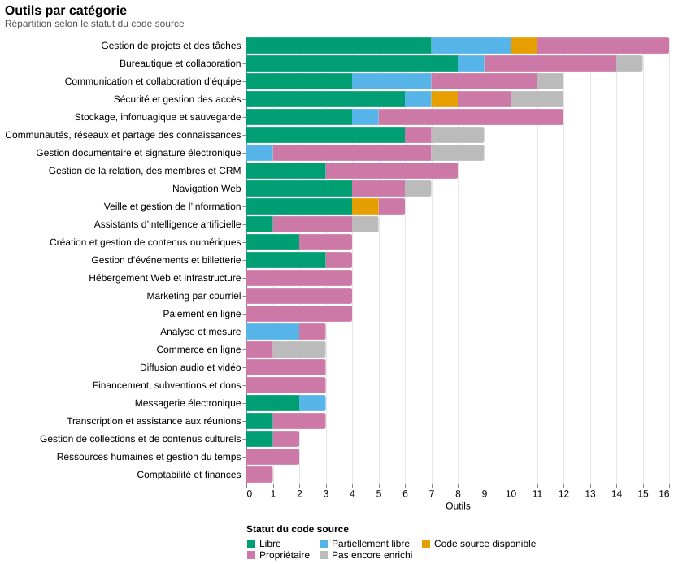
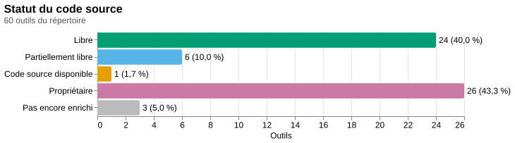
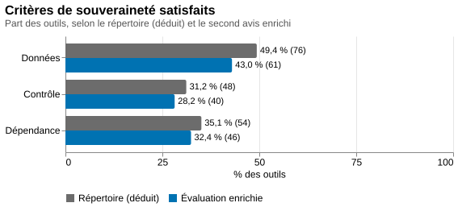
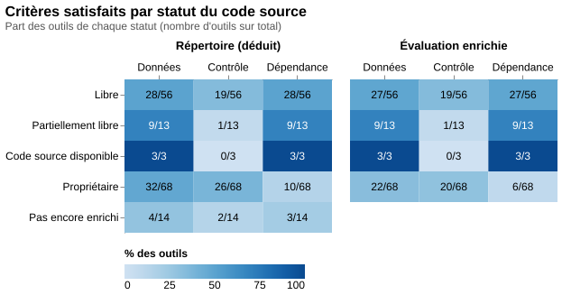
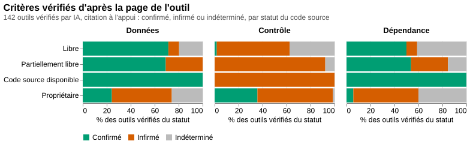
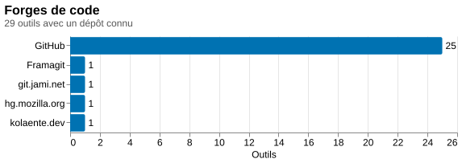
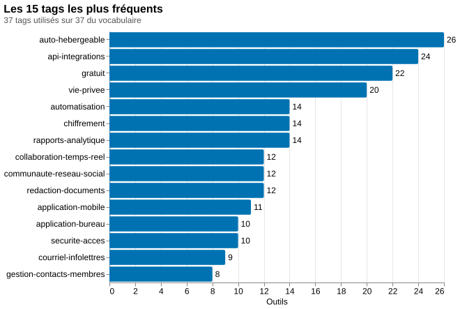

# Sommaire du répertoire d'outils favorisant la souveraineté numérique

*Documentation : [README](README.md) · [Implémentation](implementation.md) · [Historique](historique.md) · [Sommaire statistique](sommaire.md)*

Généré le 2026-11-12T17:24:09-05:00 par `sommaire.ts` d'après `outils.json` (données sous licence CC-BY-SA-4.0, créées le 2026-11-12T12:35:52-05:00 et modifiées pour la dernière fois le 2026-11-12T17:20:36-05:00). Ne pas modifier ce fichier à la main : relancer `node sommaire.ts`.

Sauf indication contraire, les pourcentages sont calculés sur les 60 outils du répertoire. Les statistiques sur le statut du code source, les licences, les forges et les tags ne portent que sur les 57 outils déjà enrichis.

## Résumé

Destiné aux OSBL des arts et de la culture du Canada français, ce répertoire rassemble 60 outils issus du répertoire de Praxis, La bande numérique. Il couvre notamment la bureautique et la collaboration, la sécurité, le stockage, la gestion de projets, le financement, la billetterie et les collections culturelles. Sa grille de souveraineté repose sur trois questions : où peuvent rester les données, qui contrôle l’outil et de qui il dépend pour fonctionner. Le score va de 0 à 3 étoiles. Dans le répertoire actuel, 52 outils obtiennent 2 étoiles et 8 obtiennent 3 étoiles, pour une moyenne de 2,13. Les critères relatifs aux données, au contrôle et à la dépendance y sont respectivement attribués à 60, 29 et 39 outils.

L’enrichissement distingue 24 logiciels libres, 6 partiellement libres, 1 outil à code source disponible et 26 solutions propriétaires, tandis que 3 fiches ne sont pas encore enrichies. Parmi les licences renseignées, le copyleft fort, notamment GPL et AGPL, domine avec 16 occurrences, devant les licences permissives avec 5 et le copyleft faible avec 4. Certaines licences restent non renseignées. Les dépôts de code recensés se trouvent principalement sur GitHub, mais aussi sur Framagit, git.jami.net et hg.mozilla.org. Les étiquettes les plus fréquentes concernent l’auto-hébergement, avec 25 outils, les API ou intégrations et la gratuité, avec 22 outils chacune. La bureautique et la collaboration est la catégorie la plus fournie, avec 8 outils, suivie de la sécurité et de la gestion des accès avec 6, puis du stockage, de l’infonuagique et de la sauvegarde avec 5.

Pour un organisme, le répertoire offre un point de départ pour repérer des solutions et les comparer selon les fonctions recherchées et le niveau de maîtrise des données souhaité. Il permet, par exemple, de rapprocher les besoins de gestion des membres, de diffusion d’infolettres ou de publication de collections des possibilités d’auto-hébergement, de chiffrement ou de fonctionnement hors ligne. La distinction entre logiciel libre, solution partiellement libre et service propriétaire aide à examiner des options différentes, sans confondre ouverture du code et souveraineté. Les descriptions et les étiquettes permettent aussi de repérer des versions gratuites, des intégrations ou des possibilités de conservation locale des données.

Ces indications décrivent une souveraineté souvent partielle et ne constituent pas une garantie d’indépendance complète. L’enrichissement porte sur 57 fiches, et les évaluations automatiques ne concordent pas toujours avec les critères attribués dans le répertoire : elles retiennent notamment le critère des données pour 47 outils, celui du contrôle pour 21 et celui de la dépendance pour 34. Des verdicts restent également indéterminés. Les scores doivent donc être lus avec les descriptions et les réserves associées, plutôt que comme une certification. Avant de choisir, il convient de vérifier les licences, les conditions d’hébergement, les dépendances techniques, les possibilités d’exportation, les fonctions comprises dans chaque édition et la disponibilité du français auprès des projets ou des fournisseurs.

*Résumé rédigé par un modèle d'IA (gpt-6.1-sol) le 2026-11-12T17:24:05-05:00, à partir des statistiques ci-dessous et de la liste des outils. À relire avant de le diffuser.*

## Chiffres clés

- **60 outils** répartis en **20 catégories**.
- **8 outils à 3 étoiles** et **52 à 2 étoiles** (moyenne : 2,13 étoiles).
- **57 outils enrichis** sur 60 (95,0 %).
- **Provenance** : Répertoire d'outils favorisant la souveraineté numérique (Praxis, La bande numérique) (60 outils).
- **30 logiciels libres ou partiellement libres** parmi les outils enrichis (52,6 %).
- **8 licences SPDX distinctes**, **4 forges de code** et **36 tags** utilisés sur 37 du vocabulaire.

## Dates

### Dans le répertoire

La page du répertoire n'affiche qu'une date pour toute la note : la date d'un outil (`derniere_modification`) est celle de la page quand l'outil a été ajouté ou a changé.

- **Outils les plus anciens** : 2026-11-05T09:53:00-05:00, 60 outil(s) (1Password, 2FAS Auth, 2FAS Pass, Antidote, Bitwarden et 55 autre(s)).
- **Outils les plus récents** : 2026-11-05T09:53:00-05:00, 60 outil(s) (1Password, 2FAS Auth, 2FAS Pass, Antidote, Bitwarden et 55 autre(s)).

| Date de modification | Outils |
|---|---|
| 2026-11-05T09:53:00-05:00 | 60 |

| Changement détecté | Outils |
|---|---|
| nouveau | 60 |

### Enrichissement

- 57 outils enrichis, dont 57 avec une date d'enrichissement enregistrée.
- **Premier enrichissement** : 2026-11-12T12:36:14-05:00 (Matomo).
- **Dernier enrichissement** : 2026-11-12T12:55:53-05:00 (Wallabag).
- Dernière écriture du fichier de données : 2026-11-12T17:20:36-05:00.

| Jour | Outils enrichis |
|---|---|
| 2026-11-12 | 57 |

## Catégories

| Catégorie | Outils | % du répertoire | Enrichis | Libres ou partiels | Score moyen |
|---|---|---|---|---|---|
| 📝 Bureautique et collaboration | 8 | 13,3 % | 8 | 6 | 2,25 |
| 🔐 Sécurité et gestion des accès | 6 | 10,0 % | 5 | 3 | 2 |
| ☁️ Stockage, infonuagique et sauvegarde | 5 | 8,3 % | 5 | 1 | 2,4 |
| 📋 Gestion de projets et des tâches | 4 | 6,7 % | 4 | 4 | 2 |
| 📣 Marketing par courriel | 4 | 6,7 % | 4 | 0 | 2,25 |
| 🌐 Communautés, réseaux et partage des connaissances | 3 | 5,0 % | 2 | 2 | 2 |
| 💬 Communication et collaboration d’équipe | 3 | 5,0 % | 3 | 3 | 2,33 |
| 🤝 Financement, subventions et dons | 3 | 5,0 % | 3 | 0 | 2 |
| 📁 Gestion documentaire et signature électronique | 3 | 5,0 % | 2 | 1 | 2 |
| 🎙️ Transcription et assistance aux réunions | 3 | 5,0 % | 3 | 1 | 2 |
| 🔎 Veille et gestion de l’information | 3 | 5,0 % | 3 | 2 | 2,33 |
| 📊 Analyse et mesure | 2 | 3,3 % | 2 | 1 | 2 |
| 🎨 Création et gestion de contenus numériques | 2 | 3,3 % | 2 | 1 | 2,5 |
| 🎟️ Gestion d’événements et billetterie | 2 | 3,3 % | 2 | 1 | 2 |
| 🏛️ Gestion de collections et de contenus culturels | 2 | 3,3 % | 2 | 1 | 2 |
| 👥 Gestion de la relation, des membres et CRM | 2 | 3,3 % | 2 | 1 | 2 |
| ⏱️ Ressources humaines et gestion du temps | 2 | 3,3 % | 2 | 0 | 2 |
| 💰 Comptabilité et finances | 1 | 1,7 % | 1 | 0 | 2 |
| ✉️ Messagerie électronique | 1 | 1,7 % | 1 | 1 | 2 |
| 🧭 Navigation Web | 1 | 1,7 % | 1 | 1 | 2 |

## Statut du code source

| Statut | Outils | % du répertoire | % des outils enrichis |
|---|---|---|---|
| Libre | 24 | 40,0 % | 42,1 % |
| Partiellement libre (open core) | 6 | 10,0 % | 10,5 % |
| Code source disponible | 1 | 1,7 % | 1,8 % |
| Propriétaire | 26 | 43,3 % | 45,6 % |
| Pas encore enrichi | 3 | 5,0 % |  |

## Licences

| Licence (SPDX) | Outils | % des outils enrichis |
|---|---|---|
| AGPL-3.0-only | 8 | 14,0 % |
| AGPL-3.0-or-later | 4 | 7,0 % |
| MPL-2.0 | 4 | 7,0 % |
| Apache-2.0 | 3 | 5,3 % |
| GPL-3.0-or-later | 2 | 3,5 % |
| MIT | 2 | 3,5 % |
| GPL-2.0-or-later | 1 | 1,8 % |
| GPL-3.0-only | 1 | 1,8 % |

**Familles de licences** (classement indicatif d'après l'identifiant SPDX) :

| Famille | Outils |
|---|---|
| Copyleft fort (GPL, AGPL) | 16 |
| Permissive (MIT, Apache, BSD, ISC) | 5 |
| Copyleft faible (LGPL, MPL, EPL, EUPL) | 4 |

**Outils enrichis sans licence connue**, par statut :

| Statut | Outils |
|---|---|
| Propriétaire | 26 |
| Libre | 4 |
| Code source disponible | 1 |
| Partiellement libre (open core) | 1 |

## Critères de souveraineté

Les critères du répertoire sont **déduits** des descriptions (voir le README) ; l'évaluation enrichie est un second avis indépendant du modèle d'IA.

### Nombre d'outils par critère (répertoire)

| Critère | Outils | % du répertoire |
|---|---|---|
| Où peuvent rester les données ? | 60 | 100,0 % |
| Qui contrôle l’outil ? | 29 | 48,3 % |
| De qui dépend-il pour fonctionner ? | 39 | 65,0 % |

### Critères satisfaits par statut du code source (répertoire)

| Statut | Outils | Où peuvent rester les données ? | Qui contrôle l’outil ? | De qui dépend-il pour fonctionner ? | Critères au total | Moyenne par outil |
|---|---|---|---|---|---|---|
| Libre | 24 | 24 | 1 | 24 | 49 | 2,04 |
| Partiellement libre (open core) | 6 | 6 | 0 | 6 | 12 | 2 |
| Code source disponible | 1 | 1 | 0 | 1 | 2 | 2 |
| Propriétaire | 26 | 26 | 26 | 7 | 59 | 2,27 |
| Pas encore enrichi | 3 | 3 | 2 | 1 | 6 | 2 |
| Ensemble | 60 | 60 | 29 | 39 | 128 | 2,13 |

### Évaluation enrichie (second avis)

| Critère | Outils | % des évaluations |
|---|---|---|
| Où peuvent rester les données ? | 47 | 82,5 % |
| Qui contrôle l’outil ? | 21 | 36,8 % |
| De qui dépend-il pour fonctionner ? | 34 | 59,6 % |

| Statut | Outils | Où peuvent rester les données ? | Qui contrôle l’outil ? | De qui dépend-il pour fonctionner ? | Critères au total | Moyenne par outil |
|---|---|---|---|---|---|---|
| Libre | 24 | 24 | 1 | 24 | 49 | 2,04 |
| Partiellement libre (open core) | 6 | 6 | 0 | 6 | 12 | 2 |
| Code source disponible | 1 | 1 | 0 | 1 | 2 | 2 |
| Propriétaire | 26 | 16 | 20 | 3 | 39 | 1,5 |
| Ensemble | 57 | 47 | 21 | 34 | 102 | 1,79 |

- **39** évaluation(s) sur 57 concordent avec le répertoire (68,4 %) ; **18** s'en écartent (Klipfolio, cDox, Kashoo, Elodia, Zeffy, CanaDon, Webnames.ca, Member365, Le point de vente, Envoke et 8 autre(s)).
- Confiance de l'évaluation enrichie : moyenne 29, élevée 26, faible 2.

### Critères vérifiés d'après la page de l'outil (citation à l'appui)

Pour chaque outil enrichi, une IA a lu la page de l'outil et répondu, critère par critère, **confirmé**, **infirmé** ou **indéterminé**, avec une citation copiée mot pour mot (champ `criteres_confirmes` de `outils.json`). Un critère indéterminé n'est pas contredit : la page ne permet simplement pas de conclure. Ce nombre peut être inférieur au nombre d'étoiles, qui reste celui de la source.

| Statut | Outils | Où peuvent rester les données ? (confirmés / infirmés / indéterminés) | Qui contrôle l’outil ? (confirmés / infirmés / indéterminés) | De qui dépend-il pour fonctionner ? (confirmés / infirmés / indéterminés) |
|---|---|---|---|---|
| Libre | 24 | 24 / 0 / 0 | 1 / 23 / 0 | 17 / 0 / 7 |
| Partiellement libre (open core) | 6 | 6 / 0 / 0 | 0 / 6 / 0 | 4 / 0 / 2 |
| Code source disponible | 1 | 1 / 0 / 0 | 0 / 1 / 0 | 1 / 0 / 0 |
| Propriétaire | 26 | 14 / 0 / 12 | 25 / 0 / 1 | 3 / 2 / 21 |
| Ensemble | 57 | 45 / 0 / 12 | 26 / 30 / 1 | 25 / 2 / 30 |

- **57** outil(s) vérifié(s) sur 57 enrichis, par gpt-6-astra (57).
- **32** outil(s) sur 57 ont autant de critères confirmés que d'étoiles (56,1 %) ; pour les autres, la page n'établit pas tous les critères que les étoiles représentent.
- **39** outil(s) sur 57 ont exactement les critères de l'évaluation enrichie (68,4 %).

## Forges de code

| Forge | Outils | Hôte(s) | Outils concernés |
|---|---|---|---|
| GitHub | 26 | github.com | 2FAS Auth, Bitwarden, CiviCRM, Collabora Online, CryptPad, Discourse et 20 autre(s) |
| Framagit | 1 | framagit.org | Mobilizon |
| git.jami.net | 1 | git.jami.net | Jami |
| hg.mozilla.org | 1 | hg.mozilla.org | Thunderbird |

- **Logiciels libres ou partiels sans dépôt connu** : La Digitale.
- Autres outils enrichis sans dépôt (propriétaires ou inconnus) : 27.

## Open Hub

Données publiques d'[Open Hub](https://www.openhub.net/) sur les logiciels au code public (champ `openhub` de `outils.json`, voir `openhub.ts`) : activité, contributeurs et commits des douze derniers mois, licences déclarées sur Open Hub.

| Outil | Projet Open Hub | Activité | Contributeurs (12 mois) | Commits (12 mois) | Licences Open Hub |
|---|---|---|---|---|---|
| Firefox | 9 | Very High | 1619 | 73478 | Mozilla Public License 2.0 |
| Nextcloud | 727926 | Not Available | 634 | 85905 | GNU Affero General Public License v3.0 |
| CiviCRM | 3256 | Very High | 376 | 10791 | GNU Affero General Public License v3.0 |
| Collabora Online | 761437 | Very High | 327 | 18007 | aucune |
| Penpot | 762685 | Very High | 232 | 5445 | Mozilla Public License 2.0 |
| Bitwarden | 729478 | Very High | 168 | 3961 | aucune |
| Euro-Office | 766962 | Very High | 162 | 6695 | aucune |
| Discourse | 633846 | Very High | 136 | 7710 | GNU General Public License v2.0 or later |
| Jitsi Meet | 714272 | Very High | 122 | 1056 | Apache License 2.0 |
| Mattermost | 724252 | Very High | 120 | 2736 | aucune |
| Matomo | 10720 | Not Available | 99 | 5467 | GNU General Public License v3.0 or later |
| Thunderbird | 36 | Very High | 93 | 4269 | Mozilla Public License 2.0 |
| OpenProject | 631944 | Very High | 89 | 19124 | GNU General Public License v3.0 only |
| Mastodon | 730083 | Very High | 86 | 3159 | GNU Affero General Public License v3.0 or later |
| Vaultwarden | 762092 | High | 58 | 230 | GNU Affero General Public License v3.0 or later |
| Leantime | 757432 | High | 45 | 846 | GNU General Public License v2.0 or later |
| Jami | 318963 | Not Available | 28 | 1884 | aucune |
| CryptPad | 731278 | High | 24 | 1002 | aucune |
| Taiga | 719594 | Moderate | 9 | 153 | GNU Affero General Public License v3.0 or later |
| DocuSeal | 763084 | High | 3 | 1029 | GNU Affero General Public License v3.0 or later |
| OnlyOffice | 486794 | Very Low | 1 | 1 | GNU Affero General Public License v3.0 |

- **21 outils** avec des données Open Hub ; activité : Very High 12, High 4, Not Available 3, Moderate 1, Very Low 1.
- Restent à chercher : La Digitale, Framapad, Omeka S, Vikunja, Mobilizon, 2FAS Auth, 2FAS Pass, Handy, Miniflux, Wallabag.

## Tags

- Moyenne de **4,39 tags par outil enrichi**.
- 36 tags utilisés sur 37 du vocabulaire; **non utilisés** : gestion-documentaire.

| Tag | Description | Outils | % des outils enrichis |
|---|---|---|---|
| auto-hebergeable | Peut être installé et exploité sur l'infrastructure de l'organisation plutôt que chez le fournisseur. | 25 | 43,9 % |
| api-integrations | Offre une API ou des intégrations avec d'autres outils et services. | 22 | 38,6 % |
| gratuit | Offre une version gratuite, entièrement ou pour les organismes admissibles. | 22 | 38,6 % |
| automatisation | Automatise des tâches, des flux de travail ou des campagnes. | 14 | 24,6 % |
| vie-privee | Mise sur la protection de la vie privée : limitation du pistage, collecte minimale de données, fonctionnement sans compte. | 14 | 24,6 % |
| rapports-analytique | Produit des rapports, des tableaux de bord ou des indicateurs de suivi. | 13 | 22,8 % |
| application-mobile | Offre une application pour téléphone ou tablette. | 10 | 17,5 % |
| redaction-documents | Rédaction, édition ou correction de textes, tableurs, présentations et autres documents. | 10 | 17,5 % |
| securite-acces | Mots de passe, authentification à deux facteurs, protection contre l'hameçonnage et gestion des accès. | 10 | 17,5 % |
| application-bureau | S'installe comme application sur l'ordinateur. | 9 | 15,8 % |
| chiffrement | Chiffre les données ou les échanges, notamment de bout en bout. | 9 | 15,8 % |
| collaboration-temps-reel | Permet de travailler à plusieurs en même temps sur un même contenu. | 9 | 15,8 % |
| courriel-infolettres | Courriel, infolettres et marketing par courriel. | 8 | 14,0 % |
| gestion-contacts-membres | Gestion de contacts, de membres, de donateurs et de la relation avec eux (CRM). | 8 | 14,0 % |
| hors-ligne | Fonctionne sans connexion Internet ou garde les données localement sur l'appareil. | 7 | 12,3 % |
| messagerie-visioconference | Messagerie, appels audio et vidéo, visioconférence. | 6 | 10,5 % |
| evenements-billetterie | Organisation d'événements, inscriptions et vente de billets. | 5 | 8,8 % |
| communaute-reseau-social | Communautés en ligne, forums et réseaux sociaux. | 4 | 7,0 % |
| gestion-projets-taches | Planification de projets, suivi de tâches et d'échéances, tableaux Kanban. | 4 | 7,0 % |
| intelligence-artificielle | Utilise l'intelligence artificielle pour ses fonctions principales (génération, transcription, assistance). | 4 | 7,0 % |
| notes-veille | Prise de notes, organisation des connaissances, flux RSS et lecture d'articles sauvegardés. | 4 | 7,0 % |
| stockage-partage-fichiers | Stockage, synchronisation et partage de fichiers. | 4 | 7,0 % |
| dons-paiements | Collecte de dons, campagnes de financement et traitement de paiements. | 3 | 5,3 % |
| federe-decentralise | Repose sur des instances indépendantes qui communiquent entre elles ou sur une architecture pair-à-pair. | 3 | 5,3 % |
| sauvegarde | Sauvegarde et récupération de données. | 3 | 5,3 % |
| transcription-reunions | Transcription de la parole, dictée vocale et comptes rendus de réunions. | 3 | 5,3 % |
| anglais-seulement | Interface ou soutien disponibles uniquement en anglais. | 2 | 3,5 % |
| collections-patrimoine | Catalogage et publication de collections, de bibliothèques et de contenus culturels. | 2 | 3,5 % |
| comptabilite-facturation | Comptabilité, facturation, suivi des dépenses et rapports financiers. | 2 | 3,5 % |
| conception-design | Conception graphique, maquettes et prototypes. | 2 | 3,5 % |
| domaines-hebergement-web | Noms de domaine, hébergement Web et services d'infrastructure en ligne. | 2 | 3,5 % |
| ressources-humaines | Dossiers d'employés, vacances, absences et feuilles de temps. | 2 | 3,5 % |
| signature-electronique | Signature électronique de documents et suivi des signataires. | 2 | 3,5 % |
| navigation-web | Navigation sur le Web. | 1 | 1,8 % |
| subventions | Recherche de subventions et préparation de demandes de financement. | 1 | 1,8 % |
| tarif-osbl | Prévoit un rabais ou une tarification particulière pour les OSBL et organismes de bienfaisance. | 1 | 1,8 % |

**Tags les plus souvent associés** :

| Paire de tags | Outils |
|---|---|
| auto-hebergeable + gratuit | 14 |
| api-integrations + auto-hebergeable | 11 |
| api-integrations + automatisation | 10 |
| api-integrations + rapports-analytique | 9 |
| auto-hebergeable + collaboration-temps-reel | 8 |
| collaboration-temps-reel + redaction-documents | 8 |
| gratuit + vie-privee | 8 |
| auto-hebergeable + redaction-documents | 7 |
| api-integrations + gratuit | 6 |
| automatisation + rapports-analytique | 6 |

## Fiabilité et suivi

- Confiance de la déduction des critères : élevée 40, moyenne 17, faible 3.
- Outils restant à enrichir : 3.
