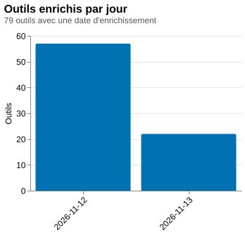

# Sommaire du répertoire d'outils favorisant la souveraineté numérique

*Documentation : [README](README.md) · [Implémentation](implementation.md) · [Historique](historique.md) · [Sommaire statistique](sommaire.md)*

Généré le 2026-11-13T10:15:57-05:00 par `sommaire.ts` d'après `outils.json` (données sous licence CC-BY-SA-4.0, créées le 2026-11-12T12:35:52-05:00 et modifiées pour la dernière fois le 2026-11-13T10:15:36-05:00). Ne pas modifier ce fichier à la main : relancer `node sommaire.ts`.

Sauf indication contraire, les pourcentages sont calculés sur les 154 outils du répertoire. Les statistiques sur le statut du code source, les licences, les forges et les tags ne portent que sur les 140 outils déjà enrichis.

## Résumé

Ce répertoire rassemble 154 outils numériques pour aider les organismes et les petites équipes du Canada français à explorer des solutions favorisant la souveraineté numérique. Il croise les ressources de Charles, consacrées aux alternatives européennes aux services américains, le répertoire de Praxis et les Services FACiLes. Les outils sont organisés par catégories et décrits à l’aide de caractéristiques d’utilisation, de renseignements sur leur code et de trois critères : où peuvent rester les données, qui contrôle l’outil et de qui il dépend pour fonctionner. Le score de 0 à 3 étoiles synthétise les critères satisfaits. Dans l’évaluation du répertoire, le critère des données est satisfait par 76 outils, celui du contrôle par 48 et celui de la dépendance par 53. Le score moyen est de 1,15 et 8 outils obtiennent 3 étoiles.

La classification distingue 56 outils libres, 13 partiellement libres, 3 à code source disponible et 68 propriétaires, tandis que 14 ne sont pas encore enrichis. Parmi les licences recensées, le copyleft fort, notamment GPL et AGPL, domine avec 45 occurrences, devant les licences permissives avec 10 et le copyleft faible avec 5. Certaines licences restent non renseignées, y compris pour des outils classés libres. GitHub est la forge la plus représentée dans les dépôts indiqués, aux côtés de Framagit, Codeberg, GitLab et de forges propres à certains projets. La disponibilité du code et son lieu d’hébergement constituent ainsi des renseignements complémentaires au score, sans se confondre avec lui.

Les catégories les plus fournies sont la gestion de projets et des tâches, avec 16 outils, et la bureautique et la collaboration, avec 15. Le répertoire couvre aussi la communication, la sécurité, le stockage, la gestion des membres, les dons et d’autres besoins organisationnels. Les caractéristiques les plus fréquentes sont les API et intégrations, présentes pour 45 outils, la gratuité pour 40, puis l’auto-hébergement et la protection de la vie privée pour 34 chacune. Ces repères permettent de constituer une sélection selon les fonctions recherchées, puis de comparer les possibilités de conservation locale des données, d’auto-hébergement, de chiffrement ou de recours à un service géré. Un organisme peut ainsi orienter son choix selon ses besoins et le niveau de maîtrise des données qu’il souhaite exercer.

Le répertoire constitue une aide au repérage plutôt qu’une garantie de souveraineté complète. Un logiciel libre ne satisfait pas nécessairement tous les critères, et un outil propriétaire peut en satisfaire plusieurs. L’enrichissement porte sur 140 outils et demeure donc partiel. Certains scores sont estimés, des classifications et évaluations reposent sur des déductions automatiques, et des écarts sont signalés entre les évaluations du répertoire et celles issues de l’enrichissement. Une note faible ou nulle doit donc être interprétée à la lumière des informations disponibles. Avant de retenir une solution, il convient de vérifier auprès du projet ou du fournisseur la licence applicable, les conditions d’hébergement, le contrôle effectif de l’outil, ses dépendances techniques et la disponibilité du français.

*Résumé rédigé par un modèle d'IA (gpt-6.1-sol) le 2026-11-13T10:15:49-05:00, à partir des statistiques ci-dessous et de la liste des outils. À relire avant de le diffuser.*

## Chiffres clés

- **154 outils** répartis en **25 catégories**.
- **8 outils à 3 étoiles** et **65 à 2 étoiles** (moyenne : 1,15 étoiles).
- **140 outils enrichis** sur 154 (90,9 %).
- **Provenance** : Charles, alternatives européennes aux services américains (extension Chrome, Yanis Kerdjana) (72 outils), Répertoire d'outils favorisant la souveraineté numérique (Praxis, La bande numérique) (60 outils), Services FACiLes (FACiL, pour l'appropriation collective de l'informatique libre) (22 outils) ; 94 outils au score estimé faute d'étoiles dans la source (Agenda du libre du Québec, Bureautique FACiLe, Canal FACiLe, Code FACiLe, Conférence FACiLe, Courriel FACiLe et 88 autre(s)).
- **Pays de l'éditeur** (quand la source le donne, 72 outils) : FR (30), CH (12), DE (12), EU (4), NL (4), NO (2), SE (2), UK (2), AT (1), DK (1), EE (1), LT (1).
- **69 logiciels libres ou partiellement libres** parmi les outils enrichis (49,3 %).
- **12 licences SPDX distinctes**, **8 forges de code** et **52 tags** utilisés sur 52 du vocabulaire.

## Dates

### Dans le répertoire

La page du répertoire n'affiche qu'une date pour toute la note : la date d'un outil (`derniere_modification`) est celle de la page quand l'outil a été ajouté ou a changé.

- **Outils les plus anciens** : 2026-09-08T17:47:04-04:00, 72 outil(s) (Adyen, Aleph Alpha, Anytype, ARD Mediathek, ARTE et 67 autre(s)).
- **Outils les plus récents** : 2026-11-12T17:41:57-05:00, 22 outil(s) (Agenda du libre du Québec, Bureautique FACiLe, Canal FACiLe, Code FACiLe, Conférence FACiLe et 17 autre(s)).

| Date de modification | Outils |
|---|---|
| 2026-11-12T17:41:57-05:00 | 22 |
| 2026-11-05T09:53:00-05:00 | 60 |
| 2026-09-08T17:47:04-04:00 | 72 |

| Changement détecté | Outils |
|---|---|
| nouveau | 154 |

### Enrichissement

- 140 outils enrichis, dont 140 avec une date d'enrichissement enregistrée.
- **Premier enrichissement** : 2026-11-12T12:36:14-05:00 (Matomo).
- **Dernier enrichissement** : 2026-11-13T10:15:28-05:00 (Wiki FACiLe).
- Dernière écriture du fichier de données : 2026-11-13T10:15:36-05:00.

| Jour | Outils enrichis |
|---|---|
| 2026-11-12 | 49 |
| 2026-11-13 | 91 |

## Catégories

| Catégorie | Outils | % du répertoire | Enrichis | Libres ou partiels | Score moyen |
|---|---|---|---|---|---|
| 📋 Gestion de projets et des tâches | 16 | 10,4 % | 16 | 10 | 1 |
| 📝 Bureautique et collaboration | 15 | 9,7 % | 13 | 9 | 1,6 |
| 💬 Communication et collaboration d’équipe | 12 | 7,8 % | 11 | 7 | 1,25 |
| 🔐 Sécurité et gestion des accès | 12 | 7,8 % | 10 | 7 | 1,08 |
| ☁️ Stockage, infonuagique et sauvegarde | 12 | 7,8 % | 11 | 5 | 1,25 |
| 🌐 Communautés, réseaux et partage des connaissances | 9 | 5,8 % | 7 | 6 | 1,11 |
| 📁 Gestion documentaire et signature électronique | 9 | 5,8 % | 7 | 1 | 0,67 |
| 👥 Gestion de la relation, des membres et CRM | 8 | 5,2 % | 8 | 3 | 0,63 |
| 🧭 Navigation Web | 7 | 4,5 % | 6 | 4 | 0,57 |
| 🔎 Veille et gestion de l’information | 6 | 3,9 % | 6 | 4 | 2 |
| 🤖 Assistants d’intelligence artificielle | 5 | 3,2 % | 4 | 1 | 0,6 |
| 🎨 Création et gestion de contenus numériques | 4 | 2,6 % | 4 | 2 | 1,75 |
| 🎟️ Gestion d’événements et billetterie | 4 | 2,6 % | 4 | 3 | 1,25 |
| 🖥️ Hébergement Web et infrastructure | 4 | 2,6 % | 4 | 0 | 0,5 |
| 📣 Marketing par courriel | 4 | 2,6 % | 4 | 0 | 2,25 |
| 💳 Paiement en ligne | 4 | 2,6 % | 4 | 0 | 0 |
| 📊 Analyse et mesure | 3 | 1,9 % | 3 | 2 | 2 |
| 🛒 Commerce en ligne | 3 | 1,9 % | 1 | 0 | 0 |
| 🎬 Diffusion audio et vidéo | 3 | 1,9 % | 3 | 0 | 0 |
| 🤝 Financement, subventions et dons | 3 | 1,9 % | 3 | 0 | 2 |
| ✉️ Messagerie électronique | 3 | 1,9 % | 3 | 3 | 1 |
| 🎙️ Transcription et assistance aux réunions | 3 | 1,9 % | 3 | 1 | 2 |
| 🏛️ Gestion de collections et de contenus culturels | 2 | 1,3 % | 2 | 1 | 2 |
| ⏱️ Ressources humaines et gestion du temps | 2 | 1,3 % | 2 | 0 | 2 |
| 💰 Comptabilité et finances | 1 | 0,6 % | 1 | 0 | 2 |

## Statut du code source

| Statut | Outils | % du répertoire | % des outils enrichis |
|---|---|---|---|
| Libre | 56 | 36,4 % | 40,0 % |
| Partiellement libre (open core) | 13 | 8,4 % | 9,3 % |
| Code source disponible | 3 | 1,9 % | 2,1 % |
| Propriétaire | 68 | 44,2 % | 48,6 % |
| Pas encore enrichi | 14 | 9,1 % |  |

## Licences

| Licence (SPDX) | Outils | % des outils enrichis |
|---|---|---|
| AGPL-3.0-only | 16 | 11,4 % |
| AGPL-3.0-or-later | 13 | 9,3 % |
| GPL-3.0-only | 7 | 5,0 % |
| MIT | 5 | 3,6 % |
| MPL-2.0 | 5 | 3,6 % |
| Apache-2.0 | 4 | 2,9 % |
| GPL-2.0-or-later | 4 | 2,9 % |
| GPL-3.0-or-later | 4 | 2,9 % |
| CECILL-B | 1 | 0,7 % |
| GPL-2.0-only | 1 | 0,7 % |
| WTFPL | 1 | 0,7 % |
| Zlib | 1 | 0,7 % |

**Familles de licences** (classement indicatif d'après l'identifiant SPDX) :

| Famille | Outils |
|---|---|
| Copyleft fort (GPL, AGPL) | 45 |
| Permissive (MIT, Apache, BSD, ISC) | 10 |
| Copyleft faible (LGPL, MPL, EPL, EUPL) | 5 |
| Autre ou non classée | 2 |

**Licences maison** (hors liste SPDX) :

| Licence | URL | Outils |
|---|---|---|
| Any Source Available License 1.0 |  | 1 |
| Sustainable Use License | https://docs.n8n.io/sustainable-use-license/ | 1 |

**Outils enrichis sans licence connue**, par statut :

| Statut | Outils |
|---|---|
| Propriétaire | 68 |
| Libre | 5 |
| Partiellement libre (open core) | 2 |
| Code source disponible | 1 |

## Critères de souveraineté

Les critères du répertoire sont **déduits** des descriptions (voir le README) ; l'évaluation enrichie est un second avis indépendant du modèle d'IA.

### Nombre d'outils par critère (répertoire)

| Critère | Outils | % du répertoire |
|---|---|---|
| Où peuvent rester les données ? | 76 | 49,4 % |
| Qui contrôle l’outil ? | 48 | 31,2 % |
| De qui dépend-il pour fonctionner ? | 53 | 34,4 % |

### Critères satisfaits par statut du code source (répertoire)

| Statut | Outils | Où peuvent rester les données ? | Qui contrôle l’outil ? | De qui dépend-il pour fonctionner ? | Critères au total | Moyenne par outil |
|---|---|---|---|---|---|---|
| Libre | 56 | 28 | 19 | 28 | 75 | 1,34 |
| Partiellement libre (open core) | 13 | 9 | 1 | 9 | 19 | 1,46 |
| Code source disponible | 3 | 3 | 0 | 3 | 6 | 2 |
| Propriétaire | 68 | 32 | 26 | 10 | 68 | 1 |
| Pas encore enrichi | 14 | 4 | 2 | 3 | 9 | 0,64 |
| Ensemble | 154 | 76 | 48 | 53 | 177 | 1,15 |

### Évaluation enrichie (second avis)

| Critère | Outils | % des évaluations |
|---|---|---|
| Où peuvent rester les données ? | 61 | 43,6 % |
| Qui contrôle l’outil ? | 40 | 28,6 % |
| De qui dépend-il pour fonctionner ? | 45 | 32,1 % |

| Statut | Outils | Où peuvent rester les données ? | Qui contrôle l’outil ? | De qui dépend-il pour fonctionner ? | Critères au total | Moyenne par outil |
|---|---|---|---|---|---|---|
| Libre | 56 | 27 | 19 | 27 | 73 | 1,3 |
| Partiellement libre (open core) | 13 | 9 | 1 | 9 | 19 | 1,46 |
| Code source disponible | 3 | 3 | 0 | 3 | 6 | 2 |
| Propriétaire | 68 | 22 | 20 | 6 | 48 | 0,71 |
| Ensemble | 140 | 61 | 40 | 45 | 146 | 1,04 |

- **121** évaluation(s) sur 140 concordent avec le répertoire (86,4 %) ; **19** s'en écartent (Klipfolio, cDox, Framapad, Kashoo, Elodia, Zeffy, CanaDon, Webnames.ca, Member365, Le point de vente et 9 autre(s)).
- Confiance de l'évaluation enrichie : moyenne 82, élevée 52, faible 6.

### Critères vérifiés d'après la page de l'outil (citation à l'appui)

Pour chaque outil enrichi, une IA a lu la page de l'outil et répondu, critère par critère, **confirmé**, **infirmé** ou **indéterminé**, avec une citation copiée mot pour mot (champ `criteres_confirmes` de `outils.json`). Un critère indéterminé n'est pas contredit : la page ne permet simplement pas de conclure. Ce nombre peut être inférieur au nombre d'étoiles, qui reste celui de la source.

| Statut | Outils | Où peuvent rester les données ? (confirmés / infirmés / indéterminés) | Qui contrôle l’outil ? (confirmés / infirmés / indéterminés) | De qui dépend-il pour fonctionner ? (confirmés / infirmés / indéterminés) |
|---|---|---|---|---|
| Libre | 56 | 40 / 5 / 11 | 1 / 34 / 21 | 28 / 5 / 23 |
| Partiellement libre (open core) | 13 | 9 / 4 / 0 | 0 / 12 / 1 | 7 / 4 / 2 |
| Code source disponible | 3 | 3 / 0 / 0 | 0 / 3 / 0 | 3 / 0 / 0 |
| Propriétaire | 68 | 17 / 33 / 18 | 25 / 42 / 1 | 4 / 36 / 28 |
| Ensemble | 140 | 69 / 42 / 29 | 26 / 91 / 23 | 42 / 45 / 53 |

- **140** outil(s) vérifié(s) sur 140 enrichis, par gpt-6.1-sol (82), gpt-6-astra (58).
- **95** outil(s) sur 140 ont autant de critères confirmés que d'étoiles (67,9 %) ; pour les autres, la page n'établit pas tous les critères que les étoiles représentent.
- **96** outil(s) sur 140 ont exactement les critères de l'évaluation enrichie (68,6 %).

## Forges de code

| Forge | Outils | Hôte(s) | Outils concernés |
|---|---|---|---|
| GitHub | 55 | github.com | 2FAS Auth, Anytype, Bitwarden, Canal FACiLe, CiviCRM, Cloudeezy et 49 autre(s) |
| Framagit | 7 | framagit.org | Agenda du libre du Québec, Dates FACiLes, Événement FACiLe, Framaforms, Minifi.ca, Mobilizon et 1 autre(s) |
| Codeberg | 2 | codeberg.org | Codeberg, Formulaire FACiLe |
| GitLab | 2 | gitlab.com | Code FACiLe, GitLab |
| gerrit.collaboraoffice.com | 1 | gerrit.collaboraoffice.com | Bureautique FACiLe |
| gerrit.wikimedia.org | 1 | gerrit.wikimedia.org | Wiki FACiLe |
| git.jami.net | 1 | git.jami.net | Jami |
| hg.mozilla.org | 1 | hg.mozilla.org | Thunderbird |

- **Logiciels libres ou partiels sans dépôt connu** : La Digitale.
- Autres outils enrichis sans dépôt (propriétaires ou inconnus) : 69.

## Open Hub

Données publiques d'[Open Hub](https://www.openhub.net/) sur les logiciels au code public (champ `openhub` de `outils.json`, voir `openhub.ts`) : activité, contributeurs et commits des douze derniers mois, licences déclarées sur Open Hub.

| Outil | Projet Open Hub | Activité | Contributeurs (12 mois) | Commits (12 mois) | Licences Open Hub |
|---|---|---|---|---|---|
| Code FACiLe | 587575 | Very High | 1678 | 89834 | MIT License |
| GitLab | 587575 | Very High | 1678 | 89834 | MIT License |
| Firefox | 9 | Very High | 1619 | 73478 | Mozilla Public License 2.0 |
| OpenCode | 766618 | Very High | 846 | 18582 | aucune |
| Nextcloud | 727926 | Not Available | 634 | 85905 | GNU Affero General Public License v3.0 |
| Nuage FACiLe | 727926 | Not Available | 634 | 85905 | GNU Affero General Public License v3.0 |
| n8n | 761435 | Very High | 390 | 10922 | Sustainable Use License |
| CiviCRM | 3256 | Very High | 376 | 10791 | GNU Affero General Public License v3.0 |
| Collabora Online | 761437 | Very High | 327 | 18007 | aucune |
| Bureautique FACiLe | 761437 | Very High | 323 | 18054 | aucune |
| Wiki FACiLe | 22 | Very High | 312 | 11995 | GNU General Public License v2.0 or later |
| Penpot | 762685 | Very High | 232 | 5445 | Mozilla Public License 2.0 |
| Bitwarden | 729478 | Very High | 168 | 3961 | aucune |
| Euro-Office | 766962 | Very High | 162 | 6695 | aucune |
| Canal FACiLe | 735045 | Very High | 149 | 2119 | GNU Affero General Public License v3.0 |
| Forums du libre du Québec | 633846 | Very High | 137 | 7701 | GNU General Public License v2.0 or later |
| Discourse | 633846 | Very High | 136 | 7710 | GNU General Public License v2.0 or later |
| Jitsi Meet | 714272 | Very High | 122 | 1056 | Apache License 2.0 |
| Conférence FACiLe | 714272 | Very High | 121 | 1062 | Apache License 2.0 |
| Équipe FACiLe | 724252 | Very High | 120 | 2736 | aucune |
| Mattermost | 724252 | Very High | 120 | 2736 | aucune |
| Matomo | 10720 | Not Available | 99 | 5467 | GNU General Public License v3.0 or later |
| Thunderbird | 36 | Very High | 93 | 4269 | Mozilla Public License 2.0 |
| OpenProject | 631944 | Very High | 89 | 19124 | GNU General Public License v3.0 only |
| Mastodon | 730083 | Very High | 86 | 3159 | GNU Affero General Public License v3.0 or later |
| Vaultwarden | 762092 | High | 58 | 230 | GNU Affero General Public License v3.0 or later |
| Recherche FACiLe | 761187 | Not Available | 51 | 789 | aucune |
| Leantime | 757432 | High | 45 | 846 | GNU General Public License v2.0 or later |
| Extrait FACiLe | 762059 | High | 34 | 830 | Creative Commons Attribution 4.0 |
| Jami | 318963 | Not Available | 28 | 1884 | aucune |
| CryptPad | 731278 | High | 24 | 1002 | aucune |
| Ébauche FACiLe | 731278 | High | 24 | 1002 | aucune |
| Plausible | 761568 | High | 23 | 627 | aucune |
| Courriel FACiLe | 762412 | Moderate | 20 | 281 | GNU Affero General Public License v3.0 |
| Tuleap | 584994 | Not Available | 15 | 6833 | GNU General Public License v2.0 or later |
| Taiga | 719594 | Moderate | 9 | 153 | GNU Affero General Public License v3.0 or later |
| Parlote FACiLe | 485371 | Low | 5 | 110 | GNU Affero General Public License v3.0 or later |
| DocuSeal | 763084 | High | 3 | 1029 | GNU Affero General Public License v3.0 or later |
| OnlyOffice | 486794 | Very Low | 1 | 1 | GNU Affero General Public License v3.0 |
| Dates FACiLes | 762846 | Not Available | 0 | 0 | GNU Affero General Public License v3.0 or later |
| Framaforms | 762801 | Inactive | 0 | 0 | aucune |
| Planète FACiLe | 316680 | Not Available | 0 | 0 | aucune |

- **42 outils** avec des données Open Hub ; activité : Very High 22, Not Available 8, High 7, Moderate 2, Inactive 1, Low 1, Very Low 1.
- Restent à chercher : Anytype, Element, Codeberg, Proton Mail, Qwant Maps, Wire, Proton Calendar, Proton Drive, Cloudeezy, Lingva Translate et 3 autre(s).
- Sans concordance sûre après plusieurs essais (candidats dans le journal de `update`) : La Digitale, Framapad, Omeka S, Vikunja, Mobilizon, 2FAS Auth, 2FAS Pass, Handy, Miniflux, Wallabag et 7 autre(s).

**Alternatives déclarées par la source** : Agenda du libre du Québec (https://www.meetup.com/, https://www.eventbrite.ca/) ; Bureautique FACiLe (https://docs.google.com/, https://www.microsoft.com/microsoft-365) ; Canal FACiLe (https://www.youtube.com/) ; Code FACiLe (https://github.com/, https://bitbucket.org/) ; Conférence FACiLe (https://www.skype.com/, https://www.whatsapp.com/, https://meet.google.com/, https://www.messenger.com/, https://apps.apple.com/app/facetime/id1110145091) ; Courriel FACiLe (https://mail.google.com/, https://outlook.live.com/) ; Dates FACiLes (https://doodle.com/) ; Ébauche FACiLe (https://docs.google.com/, https://www.microsoft.com/microsoft-365) ; Équipe FACiLe (https://slack.com/, https://www.microsoft.com/microsoft-teams, https://discord.com/) ; Événement FACiLe (https://www.facebook.com/events/, https://www.meetup.com/, https://www.eventbrite.ca/) ; Extrait FACiLe (https://pastebin.com/) ; Formulaire FACiLe (https://forms.google.com/) ; Forums du libre du Québec (https://www.facebook.com/groups/, https://groups.google.com/) ; Jasette FACiLe (https://x.com/) ; Journal FACiLe (https://www.facebook.com/, https://x.com/, https://news.google.com/, https://www.instagram.com/, https://www.reddit.com/) ; Minifi.ca (https://bitly.com/, https://goo.gl/) ; Nuage FACiLe (https://drive.google.com/, https://onedrive.live.com/, https://www.dropbox.com/) ; Parlote FACiLe (https://www.facebook.com/, https://plus.google.com/, https://x.com/) ; Planète FACiLe (https://feedly.com/, https://www.inoreader.com/) ; Recherche FACiLe (https://www.google.com/, https://www.bing.com/) ; Transfert FACiLe (https://wetransfer.com/, https://www.dropbox.com/) ; Wiki FACiLe (https://www.microsoft.com/sharepoint, https://www.atlassian.com/software/confluence) ; Qwant (https://google.com/) ; Ecosia (https://google.com/) ; Infomaniak kDrive (https://dropbox.com/, https://onedrive.live.com/, https://drive.google.com/, https://photos.google.com/, https://workspace.google.com/) ; Tresorit (https://dropbox.com/, https://drive.google.com/) ; Pixelfed (https://instagram.com/) ; XING (https://linkedin.com/) ; Anytype (https://notion.so/, https://keep.google.com/, https://airtable.com/, https://evernote.com/) ; Element (https://slack.com/) ; Whereby (https://zoom.us/, https://meet.google.com/) ; Tixeo (https://teams.microsoft.com/, https://zoom.us/) ; Cdiscount (https://amazon.com/) ; Fnac (https://amazon.com/) ; Back Market (https://amazon.com/) ; GitLab (https://github.com/) ; Codeberg (https://github.com/) ; OVHcloud (https://aws.amazon.com/, https://cloud.google.com/) ; Scaleway (https://aws.amazon.com/, https://cloud.google.com/) ; Hetzner (https://aws.amazon.com/) ; Mistral AI (https://chat.openai.com/, https://claude.ai/) ; Aleph Alpha (https://chat.openai.com/, https://claude.ai/) ; Proton Mail (https://mail.google.com/, https://workspace.google.com/) ; La Suite (Infomaniak) (https://office.com/, https://contacts.google.com/) ; Vivaldi (https://chrome.google.com/) ; Qwant Maps (https://maps.google.com/) ; Framaforms (https://docs.google.com/, https://typeform.com/, https://surveymonkey.com/) ; SwissTransfer (https://wetransfer.com/) ; Positive Group (https://salesforce.com/, https://hubspot.com/, https://mailchimp.com/, https://zendesk.com/) ; Batch (https://salesforce.com/, https://hubspot.com/, https://mailchimp.com/, https://zendesk.com/) ; Mycellia (https://sharepoint.com/, https://opentext.com/, https://docuware.com/, https://hyland.com/) ; SeaTable (https://notion.so/, https://airtable.com/) ; Wire (https://whatsapp.com/) ; Olvid (https://whatsapp.com/) ; Whaller (https://slack.com/, https://teams.microsoft.com/) ; Rainbow4all (https://slack.com/, https://teams.microsoft.com/) ; Zeeg (https://calendar.google.com/, https://calendly.com/) ; Vyte (https://calendar.google.com/, https://calendly.com/) ; Proton Calendar (https://calendar.google.com/) ; Proton Drive (https://drive.google.com/, https://photos.google.com/, https://workspace.google.com/) ; Cloudeezy (https://drive.google.com/) ; DeepL (https://translate.google.com/) ; Lingva Translate (https://translate.google.com/) ; Moodle (https://classroom.google.com/) ; Vibe (Mistral) (https://anthropic.com/) ; OpenCode (https://anthropic.com/) ; CoreUpdate (Galeax) (https://patchmypc.com/) ; Outmind (https://copilot.microsoft.com/) ; Ideta (https://intercom.com/, https://drift.com/, https://manychat.com/, https://liveperson.com/, https://chatfuel.com/) ; Scalingo (https://heroku.com/) ; ARTE (https://netflix.com/, https://primevideo.com/, https://hulu.com/, https://disneyplus.com/, https://max.com/, https://paramountplus.com/, https://tv.apple.com/, https://peacocktv.com/) ; france.tv (https://netflix.com/, https://primevideo.com/, https://hulu.com/, https://disneyplus.com/, https://max.com/, https://paramountplus.com/, https://tv.apple.com/, https://peacocktv.com/) ; ARD Mediathek (https://netflix.com/, https://primevideo.com/, https://hulu.com/, https://disneyplus.com/, https://max.com/, https://paramountplus.com/, https://tv.apple.com/, https://peacocktv.com/) ; Mollie (https://stripe.com/, https://paypal.com/) ; Adyen (https://stripe.com/, https://paypal.com/) ; SumUp (https://stripe.com/, https://paypal.com/) ; Payplug (https://stripe.com/) ; Yousign (https://docusign.com/) ; Scrive (https://docusign.com/) ; Penneo (https://docusign.com/) ; Skribble (https://docusign.com/) ; MeisterTask (https://asana.com/, https://trello.com/, https://monday.com/) ; Wimi (https://asana.com/) ; Stackfield (https://asana.com/, https://trello.com/, https://monday.com/) ; Sketch (https://figma.com/) ; involve.me (https://typeform.com/, https://surveymonkey.com/) ; n8n (https://zapier.com/, https://make.com/) ; Proton VPN (https://expressvpn.com/) ; Mullvad VPN (https://expressvpn.com/) ; Proton Pass (https://lastpass.com/) ; NordPass (https://lastpass.com/) ; Tuleap (https://asana.com/, https://trello.com/, https://monday.com/) ; Universign (https://docusign.com/).

## Tags

- Moyenne de **4,12 tags par outil enrichi**.
- 52 tags utilisés sur 52 du vocabulaire.

| Tag | Description | Outils | % des outils enrichis |
|---|---|---|---|
| api-integrations | Offre une API ou des intégrations avec d'autres outils et services. | 45 | 32,1 % |
| gratuit | Offre une version gratuite, entièrement ou pour les organismes admissibles. | 40 | 28,6 % |
| auto-hebergeable | Peut être installé et exploité sur l'infrastructure de l'organisation plutôt que chez le fournisseur. | 34 | 24,3 % |
| vie-privee | Mise sur la protection de la vie privée : limitation du pistage, collecte minimale de données, fonctionnement sans compte. | 34 | 24,3 % |
| chiffrement | Chiffre les données ou les échanges, notamment de bout en bout. | 27 | 19,3 % |
| automatisation | Automatise des tâches, des flux de travail ou des campagnes. | 26 | 18,6 % |
| porte-par-un-osbl | Développé ou exploité par un organisme à but non lucratif, une fondation ou une coopérative plutôt que par une entreprise. | 23 | 16,4 % |
| rapports-analytique | Produit des rapports, des tableaux de bord ou des indicateurs de suivi. | 22 | 15,7 % |
| hebergement-europe | Données hébergées dans l'Union européenne, en Suisse ou au Royaume-Uni, hors du droit américain. | 21 | 15,0 % |
| application-mobile | Offre une application pour téléphone ou tablette. | 19 | 13,6 % |
| intelligence-artificielle | Utilise l'intelligence artificielle pour ses fonctions principales (génération, transcription, assistance). | 19 | 13,6 % |
| application-bureau | S'installe comme application sur l'ordinateur. | 17 | 12,1 % |
| messagerie-visioconference | Messagerie, appels audio et vidéo, visioconférence. | 17 | 12,1 % |
| collaboration-temps-reel | Permet de travailler à plusieurs en même temps sur un même contenu. | 16 | 11,4 % |
| stockage-partage-fichiers | Stockage, synchronisation et partage de fichiers. | 15 | 10,7 % |
| redaction-documents | Rédaction, édition ou correction de textes, tableurs, présentations et autres documents. | 14 | 10,0 % |
| courriel-infolettres | Courriel, infolettres et marketing par courriel. | 13 | 9,3 % |
| securite-acces | Mots de passe, authentification à deux facteurs, protection contre l'hameçonnage et gestion des accès. | 13 | 9,3 % |
| communaute-reseau-social | Communautés en ligne, forums et réseaux sociaux. | 12 | 8,6 % |
| gestion-contacts-membres | Gestion de contacts, de membres, de donateurs et de la relation avec eux (CRM). | 11 | 7,9 % |
| gestion-projets-taches | Planification de projets, suivi de tâches et d'échéances, tableaux Kanban. | 11 | 7,9 % |
| hors-ligne | Fonctionne sans connexion Internet ou garde les données localement sur l'appareil. | 10 | 7,1 % |
| certification-securite | Certifié ou qualifié par une autorité ou une norme de sécurité (SecNumCloud, ANSSI, ISO 27001, SOC 2). | 9 | 6,4 % |
| federe-decentralise | Repose sur des instances indépendantes qui communiquent entre elles ou sur une architecture pair-à-pair. | 9 | 6,4 % |
| notes-veille | Prise de notes, organisation des connaissances, flux RSS et lecture d'articles sauvegardés. | 8 | 5,7 % |
| developpement-logiciel | Hébergement de code, suivi de tickets, intégration continue et déploiement d'applications. | 7 | 5,0 % |
| dons-paiements | Collecte de dons, campagnes de financement et traitement de paiements. | 7 | 5,0 % |
| evenements-billetterie | Organisation d'événements, inscriptions et vente de billets. | 7 | 5,0 % |
| signature-electronique | Signature électronique de documents et suivi des signataires. | 7 | 5,0 % |
| agenda-rendez-vous | Agenda partagé, planification de réunions et prise de rendez-vous en ligne. | 6 | 4,3 % |
| domaines-hebergement-web | Noms de domaine, hébergement Web et services d'infrastructure en ligne. | 6 | 4,3 % |
| sans-code | Création d'applications, de bases de données ou de robots conversationnels sans programmation. | 5 | 3,6 % |
| sans-publicite | Sans publicité ni revente de l'attention des personnes qui l'utilisent. | 5 | 3,6 % |
| gestion-documentaire | Classement, indexation, numérisation (OCR) et archivage de documents. | 4 | 2,9 % |
| transcription-reunions | Transcription de la parole, dictée vocale et comptes rendus de réunions. | 4 | 2,9 % |
| comptabilite-facturation | Comptabilité, facturation, suivi des dépenses et rapports financiers. | 3 | 2,1 % |
| ecoresponsable | Met de l'avant une démarche écologique : énergie renouvelable, neutralité carbone, matériel reconditionné. | 3 | 2,1 % |
| navigation-web | Navigation sur le Web. | 3 | 2,1 % |
| sauvegarde | Sauvegarde et récupération de données. | 3 | 2,1 % |
| anglais-seulement | Interface ou soutien disponibles uniquement en anglais. | 2 | 1,4 % |
| collections-patrimoine | Catalogage et publication de collections, de bibliothèques et de contenus culturels. | 2 | 1,4 % |
| conception-design | Conception graphique, maquettes et prototypes. | 2 | 1,4 % |
| moteur-de-recherche | Recherche sur le Web. | 2 | 1,4 % |
| ressources-humaines | Dossiers d'employés, vacances, absences et feuilles de temps. | 2 | 1,4 % |
| tarif-osbl | Prévoit un rabais ou une tarification particulière pour les OSBL et organismes de bienfaisance. | 2 | 1,4 % |
| telephonie | Téléphonie : appels vers le réseau téléphonique, standard et numéros. | 2 | 1,4 % |
| traduction | Traduction automatique de textes et de documents. | 2 | 1,4 % |
| vpn | Réseau privé virtuel ou résolveur DNS protecteur qui chiffre et filtre la connexion. | 2 | 1,4 % |
| cartographie | Cartes, itinéraires et géolocalisation. | 1 | 0,7 % |
| formation-en-ligne | Cours en ligne, parcours de formation et suivi des apprenants. | 1 | 0,7 % |
| gestion-des-correctifs | Déploiement des mises à jour et des correctifs de sécurité sur les postes et les serveurs. | 1 | 0,7 % |
| subventions | Recherche de subventions et préparation de demandes de financement. | 1 | 0,7 % |

**Tags les plus souvent associés** :

| Paire de tags | Outils |
|---|---|
| gratuit + vie-privee | 19 |
| api-integrations + automatisation | 17 |
| api-integrations + auto-hebergeable | 15 |
| chiffrement + vie-privee | 15 |
| api-integrations + rapports-analytique | 13 |
| auto-hebergeable + gratuit | 13 |
| api-integrations + intelligence-artificielle | 11 |
| collaboration-temps-reel + redaction-documents | 11 |
| chiffrement + gratuit | 10 |
| api-integrations + gratuit | 9 |

## Fiabilité et suivi

- Confiance de la déduction des critères : moyenne 70, élevée 66, indéterminée 11, faible 7.
- Outils restant à enrichir : 14, dont 3 abandonné(s) après 3 échecs consécutifs d'enrichissement (En commun, Paperless-ngx, CIRA Canadian Shield / Bouclier canadien).
