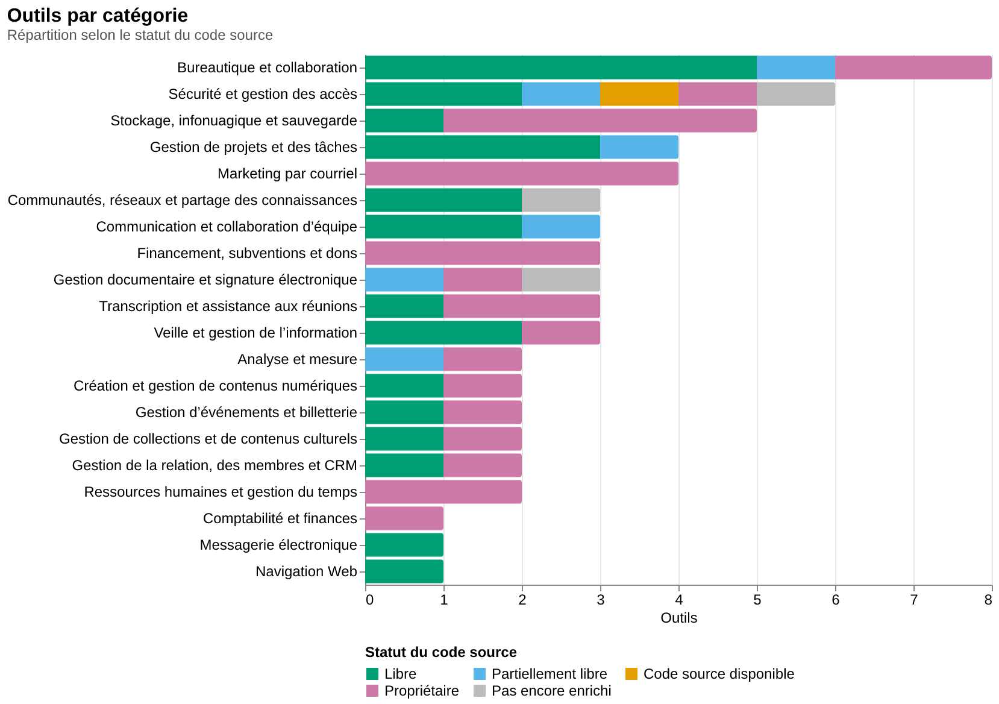
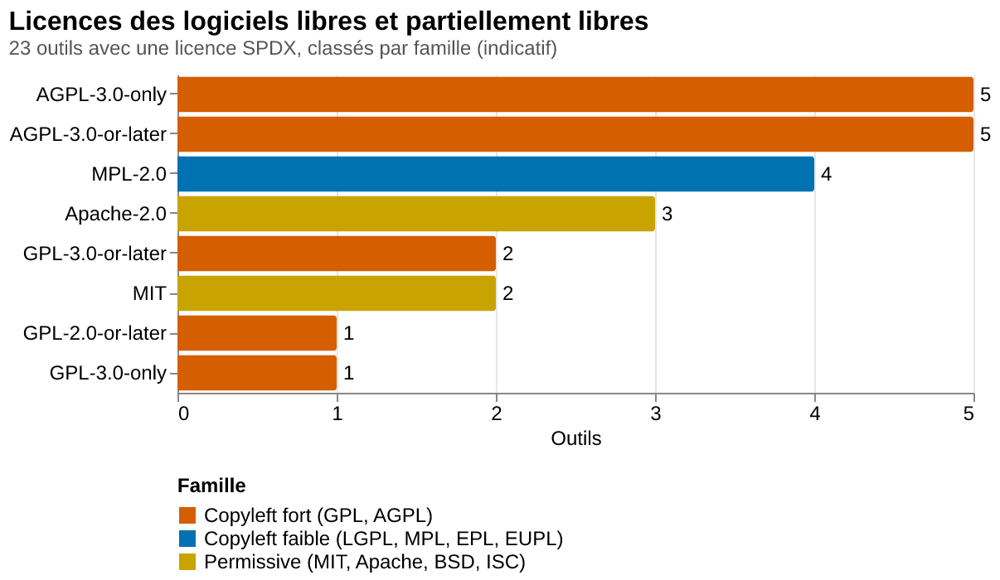
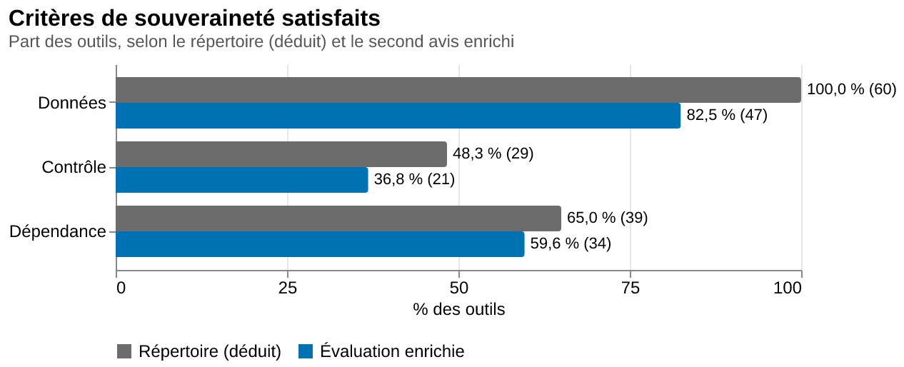
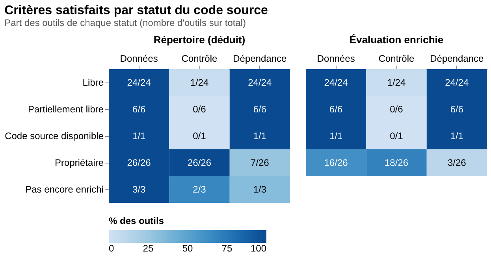
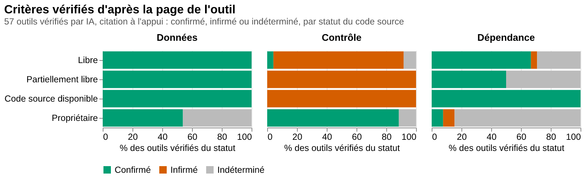
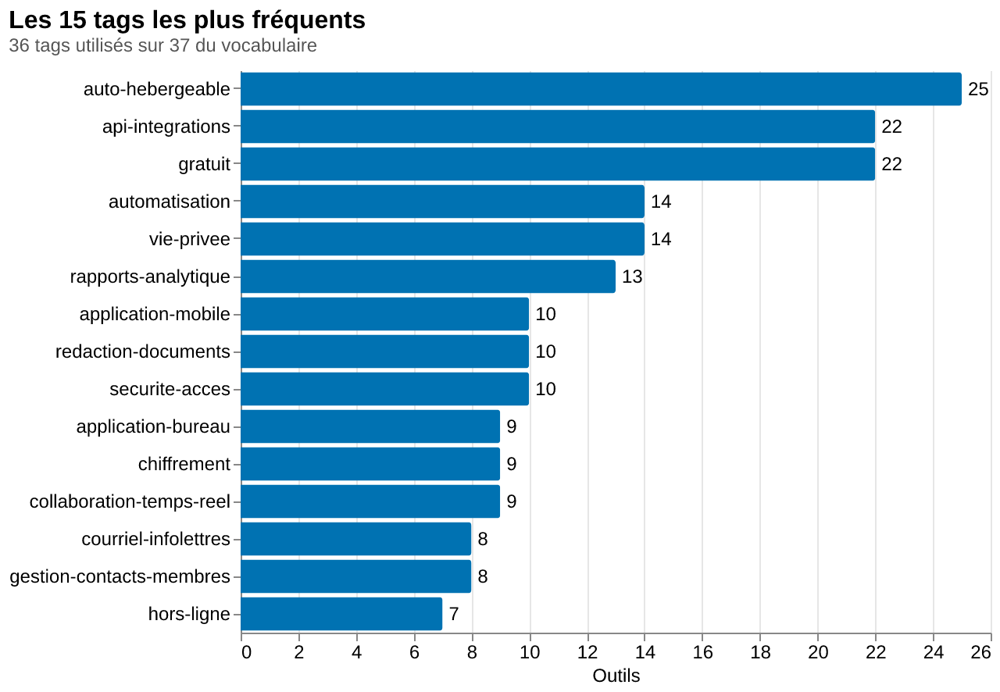

# Sommaire du répertoire d'outils favorisant la souveraineté numérique

Généré le 2026-11-12T08:30:24-05:00 par `sommaire.ts` d'après `outils.json` (données sous licence CC-BY-SA-4.0, créées le 2026-11-11T16:43:11-05:00 et modifiées pour la dernière fois le 2026-11-12T08:17:21-05:00). Ne pas modifier ce fichier à la main : relancer `nub run sommaire`.

Sauf indication contraire, les pourcentages sont calculés sur les 60 outils du répertoire. Les statistiques sur le statut du code source, les licences, les forges et les tags ne portent que sur les 57 outils déjà enrichis.

## Résumé

Ce répertoire rassemble 60 outils numériques pour aider les OSBL des arts et de la culture du Canada français à orienter leurs choix en matière de souveraineté numérique. Les fiches associent descriptions, catégories, critères et, lorsqu’elles sont enrichies, renseignements sur le code, les licences et les fonctionnalités. Le score, de 0 à 3 étoiles, repose sur trois questions : où peuvent rester les données, qui contrôle l’outil et de qui dépend-il pour fonctionner? Les scores affichés se répartissent entre 52 outils à 2 étoiles et 8 à 3 étoiles, pour une moyenne de 2,13. Dans l’évaluation du répertoire, le critère relatif aux données est satisfait par 60 outils, celui du contrôle par 29 et celui de la dépendance par 39.

La classification distingue 24 logiciels libres, 6 partiellement libres, 1 à code source disponible et 26 propriétaires; 3 outils ne sont pas encore enrichis. Le répertoire ne se limite donc pas aux logiciels libres, et la disponibilité du code ne se confond pas avec une licence libre. Parmi les licences renseignées, le copyleft fort, notamment GPL et AGPL, domine avec 14 occurrences, devant les licences permissives comme MIT et Apache avec 5, puis le copyleft faible comme MPL avec 4. La licence n’est toutefois pas renseignée pour 5 outils classés libres et 2 partiellement libres. Les dépôts de code indiqués se trouvent principalement sur GitHub, mais aussi sur Framagit, git.jami.net, hg.mozilla.org et kolaente.dev. Aucun dépôt n’est indiqué pour La Digitale.

Les catégories couvrent aussi bien les activités administratives que les besoins culturels : la bureautique et la collaboration regroupent 8 outils, la sécurité et la gestion des accès 6, le stockage, l’infonuagique et la sauvegarde 5. D’autres catégories concernent les dons, la billetterie, les membres ou les collections culturelles. Les étiquettes les plus fréquentes signalent l’auto-hébergement pour 25 outils, les API ou intégrations pour 24, une offre gratuite pour 21 et la protection de la vie privée pour 16. Ces repères permettent de comparer des solutions selon les fonctions recherchées et le niveau de maîtrise des données souhaité. Un organisme peut ainsi examiner Omeka S pour publier ses collections, CiviCRM pour gérer ses membres et donateurs, ou Nextcloud pour partager des fichiers, tout en comparant les possibilités d’auto-hébergement, de fonctionnement local et de service hébergé.

La souveraineté décrite demeure souvent partielle : conserver ses données localement ou au Canada ne signifie pas nécessairement maîtriser l’outil et toutes ses dépendances. L’enrichissement porte sur 57 outils, sans permettre d’extrapoler aux fiches restantes. Les déductions automatiques et les verdicts produits par modèle doivent aussi être distingués des scores affichés : sur les fiches enrichies, ces verdicts confirment le critère des données pour 45 outils, celui du contrôle pour 24 et celui de la dépendance pour 22, avec des cas indéterminés. Le répertoire constitue donc un point de départ pour la comparaison, non une garantie. Avant de choisir, il convient de vérifier les licences, les conditions d’hébergement, les dépendances techniques, les possibilités d’exportation, les tarifs et la disponibilité du français auprès des projets ou fournisseurs.

*Résumé rédigé par un modèle d'IA (gpt-6-astra) le 2026-11-12T08:30:15-05:00, à partir des statistiques ci-dessous et de la liste des outils. À relire avant de le diffuser.*

## Chiffres clés

- **60 outils** répartis en **20 catégories**.
- **8 outils à 3 étoiles** et **52 à 2 étoiles** (moyenne : 2,13 étoiles).
- **57 outils enrichis** sur 60 (95,0 %).
- **30 logiciels libres ou partiellement libres** parmi les outils enrichis (52,6 %).
- **8 licences SPDX distinctes**, **5 forges de code** et **37 tags** utilisés sur 37 du vocabulaire.

## Dates

### Dans le répertoire

La page du répertoire n'affiche qu'une date pour toute la note : la date d'un outil (`derniere_modification`) est celle de la page quand l'outil a été ajouté ou a changé.

- **Outils les plus anciens** : 2026-11-05T09:53:00-05:00, 60 outil(s) (1Password, 2FAS Auth, 2FAS Pass, Antidote, Bitwarden et 55 autre(s)).
- **Outils les plus récents** : 2026-11-05T09:53:00-05:00, 60 outil(s) (1Password, 2FAS Auth, 2FAS Pass, Antidote, Bitwarden et 55 autre(s)).

| Date de modification | Outils |
|---|---|
| 2026-11-05T09:53:00-05:00 | 60 |

| Changement détecté | Outils |
|---|---|
| Aucun depuis l'import | 60 |

### Enrichissement

- 57 outils enrichis, dont 57 avec une date d'enrichissement enregistrée.
- **Premier enrichissement** : 2026-11-11T17:29:24-05:00 (1Password, Antidote, Cakemail, CanaDon, cDox et 37 autre(s)).
- **Dernier enrichissement** : 2026-11-11T17:36:13-05:00 (Wallabag).
- Dernière écriture du fichier de données : 2026-11-12T08:17:21-05:00.

| Jour | Outils enrichis |
|---|---|
| 2026-11-11 | 57 |

## Catégories

| Catégorie | Outils | % du répertoire | Enrichis | Libres ou partiels | Score moyen |
|---|---|---|---|---|---|
| 📝 Bureautique et collaboration | 8 | 13,3 % | 8 | 6 | 2,25 |
| 🔐 Sécurité et gestion des accès | 6 | 10,0 % | 5 | 3 | 2 |
| ☁️ Stockage, infonuagique et sauvegarde | 5 | 8,3 % | 5 | 1 | 2,4 |
| 📋 Gestion de projets et des tâches | 4 | 6,7 % | 4 | 4 | 2 |
| 📣 Marketing par courriel | 4 | 6,7 % | 4 | 0 | 2,25 |
| 🌐 Communautés, réseaux et partage des connaissances | 3 | 5,0 % | 2 | 2 | 2 |
| 💬 Communication et collaboration d’équipe | 3 | 5,0 % | 3 | 3 | 2,33 |
| 🤝 Financement, subventions et dons | 3 | 5,0 % | 3 | 0 | 2 |
| 📁 Gestion documentaire et signature électronique | 3 | 5,0 % | 2 | 1 | 2 |
| 🎙️ Transcription et assistance aux réunions | 3 | 5,0 % | 3 | 1 | 2 |
| 🔎 Veille et gestion de l’information | 3 | 5,0 % | 3 | 2 | 2,33 |
| 📊 Analyse et mesure | 2 | 3,3 % | 2 | 1 | 2 |
| 🎨 Création et gestion de contenus numériques | 2 | 3,3 % | 2 | 1 | 2,5 |
| 🎟️ Gestion d’événements et billetterie | 2 | 3,3 % | 2 | 1 | 2 |
| 🏛️ Gestion de collections et de contenus culturels | 2 | 3,3 % | 2 | 1 | 2 |
| 👥 Gestion de la relation, des membres et CRM | 2 | 3,3 % | 2 | 1 | 2 |
| ⏱️ Ressources humaines et gestion du temps | 2 | 3,3 % | 2 | 0 | 2 |
| 💰 Comptabilité et finances | 1 | 1,7 % | 1 | 0 | 2 |
| ✉️ Messagerie électronique | 1 | 1,7 % | 1 | 1 | 2 |
| 🧭 Navigation Web | 1 | 1,7 % | 1 | 1 | 2 |

## Statut du code source

| Statut | Outils | % du répertoire | % des outils enrichis |
|---|---|---|---|
| Libre | 24 | 40,0 % | 42,1 % |
| Partiellement libre (open core) | 6 | 10,0 % | 10,5 % |
| Code source disponible | 1 | 1,7 % | 1,8 % |
| Propriétaire | 26 | 43,3 % | 45,6 % |
| Pas encore enrichi | 3 | 5,0 % |  |

## Licences

| Licence (SPDX) | Outils | % des outils enrichis |
|---|---|---|
| AGPL-3.0-only | 5 | 8,8 % |
| AGPL-3.0-or-later | 5 | 8,8 % |
| MPL-2.0 | 4 | 7,0 % |
| Apache-2.0 | 3 | 5,3 % |
| GPL-3.0-or-later | 2 | 3,5 % |
| MIT | 2 | 3,5 % |
| GPL-2.0-or-later | 1 | 1,8 % |
| GPL-3.0-only | 1 | 1,8 % |

**Familles de licences** (classement indicatif d'après l'identifiant SPDX) :

| Famille | Outils |
|---|---|
| Copyleft fort (GPL, AGPL) | 14 |
| Permissive (MIT, Apache, BSD, ISC) | 5 |
| Copyleft faible (LGPL, MPL, EPL, EUPL) | 4 |

**Outils enrichis sans licence connue**, par statut :

| Statut | Outils |
|---|---|
| Propriétaire | 26 |
| Libre | 5 |
| Partiellement libre (open core) | 2 |
| Code source disponible | 1 |

## Critères de souveraineté

Les critères du répertoire sont **déduits** des descriptions (voir le README) ; l'évaluation enrichie est un second avis indépendant du modèle d'IA.

### Nombre d'outils par critère (répertoire)

| Critère | Outils | % du répertoire |
|---|---|---|
| Où peuvent rester les données ? | 60 | 100,0 % |
| Qui contrôle l’outil ? | 29 | 48,3 % |
| De qui dépend-il pour fonctionner ? | 39 | 65,0 % |

### Critères satisfaits par statut du code source (répertoire)

| Statut | Outils | Où peuvent rester les données ? | Qui contrôle l’outil ? | De qui dépend-il pour fonctionner ? | Critères au total | Moyenne par outil |
|---|---|---|---|---|---|---|
| Libre | 24 | 24 | 1 | 24 | 49 | 2,04 |
| Partiellement libre (open core) | 6 | 6 | 0 | 6 | 12 | 2 |
| Code source disponible | 1 | 1 | 0 | 1 | 2 | 2 |
| Propriétaire | 26 | 26 | 26 | 7 | 59 | 2,27 |
| Pas encore enrichi | 3 | 3 | 2 | 1 | 6 | 2 |
| Ensemble | 60 | 60 | 29 | 39 | 128 | 2,13 |

### Évaluation enrichie (second avis)

| Critère | Outils | % des évaluations |
|---|---|---|
| Où peuvent rester les données ? | 47 | 82,5 % |
| Qui contrôle l’outil ? | 19 | 33,3 % |
| De qui dépend-il pour fonctionner ? | 34 | 59,6 % |

| Statut | Outils | Où peuvent rester les données ? | Qui contrôle l’outil ? | De qui dépend-il pour fonctionner ? | Critères au total | Moyenne par outil |
|---|---|---|---|---|---|---|
| Libre | 24 | 24 | 1 | 24 | 49 | 2,04 |
| Partiellement libre (open core) | 6 | 6 | 0 | 6 | 12 | 2 |
| Code source disponible | 1 | 1 | 0 | 1 | 2 | 2 |
| Propriétaire | 26 | 16 | 18 | 3 | 37 | 1,42 |
| Ensemble | 57 | 47 | 19 | 34 | 100 | 1,75 |

- **39** évaluation(s) sur 57 concordent avec le répertoire (68,4 %) ; **18** s'en écartent (Klipfolio, cDox, Kashoo, Elodia, Zeffy, CanaDon, Webnames.ca, Member365, Le point de vente, Envoke et 8 autre(s)).
- Confiance de l'évaluation enrichie : moyenne 28, élevée 27, faible 2.

### Critères vérifiés d'après la page de l'outil (citation à l'appui)

Pour chaque outil enrichi, une IA a lu la page de l'outil et répondu, critère par critère, **confirmé**, **infirmé** ou **indéterminé**, avec une citation copiée mot pour mot (champ `criteres_confirmes` de `outils.json`). Un critère indéterminé n'est pas contredit : la page ne permet simplement pas de conclure. Ce nombre peut être inférieur au nombre d'étoiles, qui reste celui de la source.

| Statut | Outils | Où peuvent rester les données ? (confirmés / infirmés / indéterminés) | Qui contrôle l’outil ? (confirmés / infirmés / indéterminés) | De qui dépend-il pour fonctionner ? (confirmés / infirmés / indéterminés) |
|---|---|---|---|---|
| Libre | 24 | 24 / 0 / 0 | 1 / 21 / 2 | 16 / 1 / 7 |
| Partiellement libre (open core) | 6 | 6 / 0 / 0 | 0 / 6 / 0 | 3 / 0 / 3 |
| Code source disponible | 1 | 1 / 0 / 0 | 0 / 1 / 0 | 1 / 0 / 0 |
| Propriétaire | 26 | 14 / 0 / 12 | 23 / 0 / 3 | 2 / 2 / 22 |
| Ensemble | 57 | 45 / 0 / 12 | 24 / 28 / 5 | 22 / 3 / 32 |

- **57** outil(s) vérifié(s) sur 57 enrichis, par claude-fable-5-2 (57).
- **29** outil(s) sur 57 ont autant de critères confirmés que d'étoiles (50,9 %) ; pour les autres, la page n'établit pas tous les critères que les étoiles représentent.
- **34** outil(s) sur 57 ont exactement les critères de l'évaluation enrichie (59,6 %).

## Forges de code

| Forge | Outils | Hôte(s) | Outils concernés |
|---|---|---|---|
| GitHub | 25 | github.com | 2FAS Auth, Bitwarden, CiviCRM, Collabora Online, CryptPad, Discourse et 19 autre(s) |
| Framagit | 1 | framagit.org | Mobilizon |
| git.jami.net | 1 | git.jami.net | Jami |
| hg.mozilla.org | 1 | hg.mozilla.org | Thunderbird |
| kolaente.dev | 1 | kolaente.dev | Vikunja |

- **Logiciels libres ou partiels sans dépôt connu** : La Digitale.
- Autres outils enrichis sans dépôt (propriétaires ou inconnus) : 27.

## Tags

- Moyenne de **4,42 tags par outil enrichi**.
- 37 tags utilisés sur 37 du vocabulaire.

| Tag | Description | Outils | % des outils enrichis |
|---|---|---|---|
| auto-hebergeable | Peut être installé et exploité sur l'infrastructure de l'organisation plutôt que chez le fournisseur. | 25 | 43,9 % |
| api-integrations | Offre une API ou des intégrations avec d'autres outils et services. | 24 | 42,1 % |
| gratuit | Offre une version gratuite, entièrement ou pour les organismes admissibles. | 21 | 36,8 % |
| vie-privee | Mise sur la protection de la vie privée : limitation du pistage, collecte minimale de données, fonctionnement sans compte. | 16 | 28,1 % |
| automatisation | Automatise des tâches, des flux de travail ou des campagnes. | 13 | 22,8 % |
| rapports-analytique | Produit des rapports, des tableaux de bord ou des indicateurs de suivi. | 13 | 22,8 % |
| chiffrement | Chiffre les données ou les échanges, notamment de bout en bout. | 11 | 19,3 % |
| application-bureau | S'installe comme application sur l'ordinateur. | 9 | 15,8 % |
| application-mobile | Offre une application pour téléphone ou tablette. | 9 | 15,8 % |
| collaboration-temps-reel | Permet de travailler à plusieurs en même temps sur un même contenu. | 9 | 15,8 % |
| redaction-documents | Rédaction, édition ou correction de textes, tableurs, présentations et autres documents. | 9 | 15,8 % |
| gestion-contacts-membres | Gestion de contacts, de membres, de donateurs et de la relation avec eux (CRM). | 8 | 14,0 % |
| hors-ligne | Fonctionne sans connexion Internet ou garde les données localement sur l'appareil. | 8 | 14,0 % |
| securite-acces | Mots de passe, authentification à deux facteurs, protection contre l'hameçonnage et gestion des accès. | 8 | 14,0 % |
| courriel-infolettres | Courriel, infolettres et marketing par courriel. | 7 | 12,3 % |
| messagerie-visioconference | Messagerie, appels audio et vidéo, visioconférence. | 6 | 10,5 % |
| evenements-billetterie | Organisation d'événements, inscriptions et vente de billets. | 5 | 8,8 % |
| stockage-partage-fichiers | Stockage, synchronisation et partage de fichiers. | 5 | 8,8 % |
| dons-paiements | Collecte de dons, campagnes de financement et traitement de paiements. | 4 | 7,0 % |
| gestion-projets-taches | Planification de projets, suivi de tâches et d'échéances, tableaux Kanban. | 4 | 7,0 % |
| intelligence-artificielle | Utilise l'intelligence artificielle pour ses fonctions principales (génération, transcription, assistance). | 4 | 7,0 % |
| notes-veille | Prise de notes, organisation des connaissances, flux RSS et lecture d'articles sauvegardés. | 4 | 7,0 % |
| anglais-seulement | Interface ou soutien disponibles uniquement en anglais. | 3 | 5,3 % |
| federe-decentralise | Repose sur des instances indépendantes qui communiquent entre elles ou sur une architecture pair-à-pair. | 3 | 5,3 % |
| sauvegarde | Sauvegarde et récupération de données. | 3 | 5,3 % |
| signature-electronique | Signature électronique de documents et suivi des signataires. | 3 | 5,3 % |
| transcription-reunions | Transcription de la parole, dictée vocale et comptes rendus de réunions. | 3 | 5,3 % |
| collections-patrimoine | Catalogage et publication de collections, de bibliothèques et de contenus culturels. | 2 | 3,5 % |
| communaute-reseau-social | Communautés en ligne, forums et réseaux sociaux. | 2 | 3,5 % |
| conception-design | Conception graphique, maquettes et prototypes. | 2 | 3,5 % |
| domaines-hebergement-web | Noms de domaine, hébergement Web et services d'infrastructure en ligne. | 2 | 3,5 % |
| ressources-humaines | Dossiers d'employés, vacances, absences et feuilles de temps. | 2 | 3,5 % |
| comptabilite-facturation | Comptabilité, facturation, suivi des dépenses et rapports financiers. | 1 | 1,8 % |
| gestion-documentaire | Classement, indexation, numérisation (OCR) et archivage de documents. | 1 | 1,8 % |
| navigation-web | Navigation sur le Web. | 1 | 1,8 % |
| subventions | Recherche de subventions et préparation de demandes de financement. | 1 | 1,8 % |
| tarif-osbl | Prévoit un rabais ou une tarification particulière pour les OSBL et organismes de bienfaisance. | 1 | 1,8 % |

**Tags les plus souvent associés** :

| Paire de tags | Outils |
|---|---|
| api-integrations + auto-hebergeable | 13 |
| auto-hebergeable + gratuit | 13 |
| api-integrations + automatisation | 9 |
| api-integrations + rapports-analytique | 9 |
| auto-hebergeable + collaboration-temps-reel | 8 |
| collaboration-temps-reel + redaction-documents | 7 |
| gratuit + vie-privee | 7 |
| api-integrations + gratuit | 6 |
| auto-hebergeable + redaction-documents | 6 |
| auto-hebergeable + vie-privee | 6 |

## Fiabilité et suivi

- Confiance de la déduction des critères : élevée 40, moyenne 17, faible 3.
- Outils enrichis **sans page lisible** (résultat moins fiable) : aucun.
- Outils restant à enrichir : 3.
